<div align="center">

[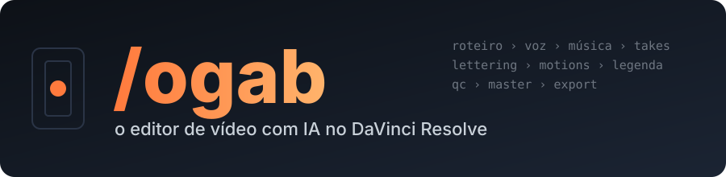](#readme)

[](https://github.com/gabrielxreis/ogab/commits/main "Histórico")
[](https://claude.com/claude-code "Claude Code")
[](#requisitos "Requisitos")
[](premiere/README.md "Premiere")
[](aftereffects/README.md "After Effects")
[](#instalacao "Instalação")
[](windows/README.md "Windows")
[](#requisitos "Requisitos")
[](LICENSE "Licença")

</div>

**/ogab** (o Gab) é uma skill do Claude Code que edita vídeo para redes sociais **no DaVinci Resolve ou no Adobe Premiere Pro** (Mac e Windows), com motions automáticos ou montados **no After Effects** em camadas editáveis: do roteiro aprovado até a timeline pronta e o MP4 masterizado, com narração por IA, música, efeitos sonoros, takes de banco ou gerados, lettering animado, motions (HyperFrames), legenda com métrica e conferência automática. Também edita gravações de apresentador (talking head) já abertas no DaVinci e cuida do **Instagram**: legenda do post, carrossel, hashtags, semana de conteúdo e perfil.

<div align="center">

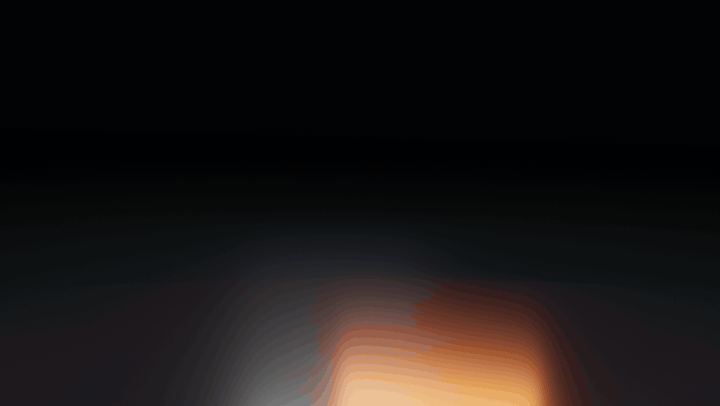

<sub><b>3D de verdade no Blender:</b> claquete com a marca em metal, chão espelhado e câmera em movimento (<code>tresd/cenas/claquete.py</code>).</sub>

<br>

**Motions que o Gab cria** (HyperFrames, 1080x1920, cores e fonte do cliente)

| Contador | Lista | Lettering | Gráfico | CTA |
|:---:|:---:|:---:|:---:|:---:|
| 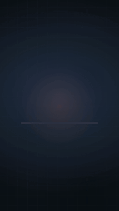 | 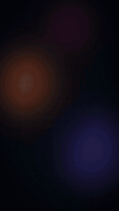 | 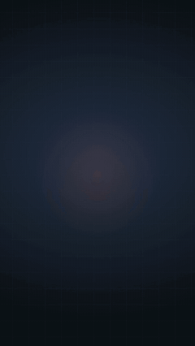 | 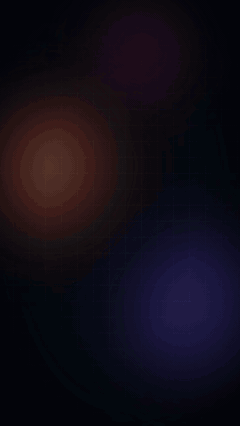 | 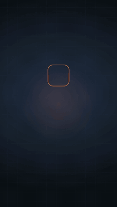 |

<sub>Exemplos com dados fictícios, na identidade do próprio Gab. Num vídeo de cliente, as cores, a fonte e a logo vêm do site da marca.</sub>

</div>

> **Cada pessoa usa as PRÓPRIAS contas.** A skill não traz conta, chave nem login. Você conecta os seus serviços (ElevenLabs, Artlist, Envato, Magnific...) no seu Claude e faz login nos sites no seu navegador. Nada disso vai para o repositório nem para o `config.json`.

* [NOVIDADES](#novidades)
* [INSTALAÇÃO](#instalacao)
    * [Um comando](#um-comando)
    * [Passo a passo manual](#passo-a-passo-manual)
    * [Atualizar](#atualizar)
    * [Requisitos](#requisitos)
* [USO E COMANDOS](#uso-e-comandos)
    * [Comandos](#comandos)
    * [O fluxo](#o-fluxo)
    * [Editar um vídeo que já está no DaVinci](#editar-um-video-que-ja-esta-no-davinci)
* [CONFIGURAÇÃO](#configuracao)
    * [Opções](#opcoes)
    * [Cor e vídeos de iPhone](#cor-e-videos-de-iphone)
* [PRESETS DE EDIÇÃO](#presets-de-edicao)
* [CLIENTES](#clientes)
    * [Perfil, pronúncia e estilo de edição](#perfil-pronuncia-e-estilo-de-edicao)
* [INSTAGRAM](#instagram)
* [PASTA DO VÍDEO](#pasta-do-video)
* [LEGENDA](#legenda)
* [EDITORES E MOTIONS](#editores-e-motions)
* [MOTIONS](#motions)
    * [Biblioteca de motions](#biblioteca-de-motions)
* [ÁUDIO E EXPORT](#audio-e-export)
* [SCRIPTS](#scripts)
* [ARMADILHAS CONHECIDAS](#armadilhas-conhecidas)
* [ESTRUTURA DO REPOSITÓRIO](#estrutura-do-repositorio)
* [LICENÇA](#licenca)


# NOVIDADES

O Gab se atualiza sozinho toda vez que você usa e **mostra o que mudou** logo no começo da conversa. Histórico completo em [`CHANGELOG.md`](CHANGELOG.md). Últimas:

- **Instagram dentro do Gab:** legenda com gancho nos primeiros 125 caracteres, carrossel slide a slide, gancho de Reel viral, 3-5 hashtags dimensionadas, texto sem cara de IA, semana de conteúdo, perfil e dados do nicho. Publica e agenda pela Publora se você quiser.
- **B-roll real no trecho certo:** o Gab acha onde a pessoa fala o que você pediu (pela legenda, capítulos e descrição do vídeo), olha uma folha de quadros antes de baixar e busca também no acervo da **NASA** e no **Wikimedia Commons** (domínio público, licença anotada). Lista posts de um perfil do **TikTok** sem login e tira **print vertical** de site ou notícia.
- **Sonorização sem chave de IA:** lê o vídeo (o que entra, bate ou para, e de que lado da tela) e monta o som em camadas, com câmera lenta que se ouve, chão e ação certos e cada som conferido por um classificador de áudio.
- **3D de verdade no Blender:** logo e texto extrudados em metal, objetos (diploma, troféu, avião) e morph de formas, com fundo transparente.
- **Tracking:** texto que segue o rosto ou o objeto, no DaVinci, no Premiere e no After Effects.
- **After Effects:** motions em camadas editáveis com glow lines, letter stretch, texto cinético, morphing e câmera 3D.
- **Premiere Pro 2026** como editor (além do DaVinci), **biblioteca de motions** que vira MOGRT, instalador do **Windows** e **doctor** que confere e corrige a instalação.

# INSTALAÇÃO

[](#um-comando)
[](install.sh)
[](https://github.com/heygen-com/hyperframes)
[](docs/PROVEDORES.md)

## Primeiro uso (leia isto)

Depois de instalar, abra o Claude Code e digite **`/ogab comecar`**. O Gab explica em 1 minuto:
- **Como pedir:** `/ogab edita o vídeo X do cliente Y`, `/ogab faz um reels para Y sobre Z`, ou mande o site/briefing de um cliente novo.
- **Onde ele para e espera você:** roteiro, voz, **legenda** (valide antes dos motions: o tempo de tudo depende dela), música.
- **O que você recebe no fim de cada ação:** só uma barrinha (`▰▰▰▱ 4 de 9`, o que falta, o próximo passo).
- **Como gastar menos tokens:** uma conversa por vídeo; para retomar, `/ogab continua o vídeo X` (ele lê o `PROJETO.md` da pasta do vídeo, que guarda status, decisões, arquivos e pendências); peça várias coisas de uma vez; avise quando mexer na timeline.

Guia completo: [`docs/BEM_VINDO.md`](docs/BEM_VINDO.md). O `SKILL.md` é só o mapa; cada etapa tem seu arquivo em `docs/etapas/`, lido só quando chega nela.

## Um comando

Cole no **Terminal** do Mac:

```bash
curl -fsSL https://raw.githubusercontent.com/gabrielxreis/ogab/main/install.sh | bash
```

No **Windows**, no PowerShell (usuário normal):

```powershell
irm https://raw.githubusercontent.com/gabrielxreis/ogab/main/windows/install.ps1 | iex
```

O instalador faz **duas perguntas**, que só escolhem qual app o Gab usa (tudo é instalado mesmo assim):
1. **Editor:** DaVinci Resolve ou Adobe Premiere Pro.
2. **Motions:** automáticos (HyperFrames) ou no After Effects (camadas editáveis).

Trocar depois, sem reinstalar: `/ogab config editor davinci|premiere` e `/ogab config motion hyperframes|aftereffects`.

O [install.sh](install.sh) pode ser rodado de novo para atualizar. Ele:
- instala **Homebrew** (se faltar), **ffmpeg**, **yt-dlp**, **Node.js**, **Python 3**, **git** e **Pillow**;
- baixa a skill em `~/.claude/skills/ogab` e cria o seu `config.json`;
- instala o **HyperFrames** e roda o `hyperframes doctor`;
- instala as fontes livres (Poppins, Playfair Display, Lobster) e o **lettering animado** (@gabrielxreis_ Text Presets) no DaVinci;
- confere o **DaVinci Resolve Studio** e o scripting, **detecta a versão** e, abaixo da 21.1, instala o **Whisper local** para a transcrição;
- instala a parte do **Premiere** (plugin Gab Ponte, LUT DO GAB e os MOGRTs da biblioteca) e do **After Effects** (extensão Gab Ponte AE);
- no fim roda o **doctor**, que confere tudo e corrige sozinho o que der, e diz em uma linha o que só você pode fazer.

Depois falta só o que depende de você: ligar o scripting no DaVinci, conectar as suas contas e o Claude in Chrome (passos 5, 8 e 9 abaixo). Reinicie o Claude Code e peça um vídeo.

## Passo a passo manual

1. **HyperFrames** (motions e edição dinâmica):
   ```bash
   npx skills add heygen-com/hyperframes
   ```
2. **Clonar na pasta de skills do Claude:**
   ```bash
   git clone https://github.com/gabrielxreis/ogab ~/.claude/skills/ogab
   ```
3. **Criar a sua configuração** (fica só na sua máquina):
   ```bash
   cp ~/.claude/skills/ogab/config.example.json ~/.claude/skills/ogab/config.json
   ```
4. **Dependências Python:**
   ```bash
   pip3 install pillow pyobjc-framework-Vision
   ```
   O `pyobjc-framework-Vision` é o OCR da Apple usado pelo `legenda_ui.py`.
5. **No DaVinci:** Preferences > System > General > **External scripting using: Local**.
6. **Fontes:** instale as de `assets/fontes/` (licença OFL). O preset de legenda padrão usa **Poppins Bold**.
7. **Lettering animado:** o pacote **@gabrielxreis_ Text Presets** (29 animações: Cinematic, Palavra Por Palavra, Blur Up, Destacado, Zoom Out...) vem em [`assets/lettering/`](assets/lettering) e o instalador já copia para `~/Library/Application Support/Blackmagic Design/DaVinci Resolve/Fusion/Templates/`. Na mão: copie o `.drfx` para essa pasta e **reinicie o Resolve**. Para usar outro pacote, coloque os nomes em `config.json > lettering`.
8. **Conectar as SUAS contas** ([docs/PROVEDORES.md](docs/PROVEDORES.md)): ElevenLabs, Artlist, Envato, Magnific etc. Só o que você usa.
9. **Claude in Chrome:** instale a extensão e faça login nos sites. Downloads são sempre pelo navegador; a IA nunca digita senha.
10. **Acessibilidade:** dê permissão de Acessibilidade ao app que roda o Claude Code (Ajustes do Sistema > Privacidade e Segurança > Acessibilidade). Só é necessário para os ajustes de legenda feitos pela interface.

> **Skill complementar recomendada:** `competitor-profiling` (pacote `anthropic-skills`). Quando você manda o site de uma empresa, a skill usa ela para montar o perfil completo antes de começar.

## Relatos de erro (opcional e anônimo)

Na instalação (ou na primeira vez que o Gab abre) ele pergunta uma vez se pode mandar relatos anônimos dos erros da skill que corrigiu no seu computador. Com "sim", ele envia sozinho em segundo plano: só o erro, a causa e a correção no código da skill (caminhos, nomes, clientes, e-mails e chaves são apagados antes). O Gabriel corrige no repositório e todo mundo recebe no auto-update. Mudar: `/ogab config relatos sim|nao`. Detalhes: `relatos/LEIA.md`.

## Atualizar

A skill faz `git pull` sozinha toda vez que é usada (sem tocar no seu `config.json` nem em `clientes/`) e, se veio coisa nova, **mostra as novidades** antes de seguir. Se o update travar por alguma mudança local sua, o `/ogab doctor` guarda a mudança (sem apagar) e atualiza. Para forçar:

```
/ogab update
```

## Requisitos

| | Mínimo | Observação |
|---|---|---|
| Sistema | macOS ou Windows 10/11 | Testado em Apple Silicon; diferenças do Windows em [`windows/README.md`](windows/README.md) |
| Editor | **DaVinci Resolve Studio 21.1+** ou **Adobe Premiere Pro 2026+** | DaVinci: a versão grátis não tem scripting externo. Premiere: ver [`premiere/README.md`](premiere/README.md) |
| After Effects | 2024+ (só se escolher motions no AE) | Ver [`aftereffects/README.md`](aftereffects/README.md) |
| Python | 3.10+ | Pillow; `pyobjc-framework-Vision` para o `legenda_ui.py` |
| ffmpeg | qualquer recente | Conversão, loudness, master, conferência |
| yt-dlp | qualquer recente (`brew upgrade yt-dlp` se o YouTube mudar) | B-roll de material real: achar e baixar só o trecho de YouTube, TikTok etc. (`baixar_video.py`) |
| Blender | qualquer recente (o instalador instala) | Logo, texto e objetos em 3D (`tresd/`) |
| Google Chrome | qualquer recente | Print de site/notícia (`baixar_video.py print`) e downloads pelo Claude in Chrome |
| Node.js | 18+ | HyperFrames |
| Docker Desktop | **não precisa** | O `hyperframes doctor` avisa "Docker: not found", mas o HyperFrames só usa Docker no render com `--docker`, que o Gab não usa. Pode ignorar |


# USO E COMANDOS

## Comandos

No Claude Code, chame com `/ogab` seguido do pedido, ou só peça em linguagem normal:

| Comando | O que faz |
|---|---|
| `/ogab faz um vídeo para a <empresa> sobre <tema>` | Fluxo completo, do roteiro ao export |
| `/ogab <edição no DaVinci>` | Edita a timeline aberta (cortes, legenda, música, motions, b-roll...) |
| `/ogab cliente <nome>` | Cria ou atualiza o perfil do cliente (site, logo, pronúncias, estilo) |
| `/ogab pauta <cliente>` | Busca notícias recentes dos temas do cliente e sugere roteiros |
| `/ogab instagram <pedido>` | Legenda, carrossel, hashtags, semana de posts, perfil (também funciona só pedindo, sem a palavra) |
| `/ogab config <chave> <valor>` | Liga ou desliga opções. Ex.: `config opcoes.multi_formatos true` |
| `/ogab ajuda` | Mostra o que está habilitado e os provedores escolhidos |
| `/ogab doctor` | Confere a instalação inteira, corrige o que der e guia você no resto |
| `/ogab comecar` | Primeiro uso: roda o doctor e explica como pedir |
| `/ogab config editor premiere` | Troca o editor (`davinci` ou `premiere`) |
| `/ogab config motion aftereffects` | Troca os motions (`hyperframes` ou `aftereffects`) |
| `/ogab update` | Atualiza a skill |

## O fluxo

<p align="center">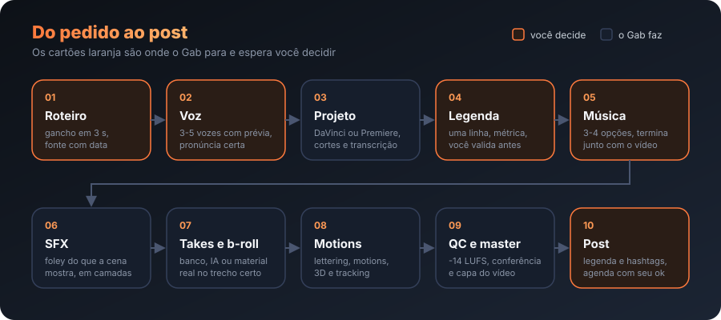</p>

| # | Etapa | Você decide? | Ferramenta |
|---|---|---|---|
| 1 | Perfil do cliente + logos e identidade visual baixadas do site | Só na 1ª vez | `competitor-profiling`, `marca.py` |
| 2 | **Roteiro** no formato da plataforma (Instagram, YouTube, Meta Ads) | **Aprova** | Pesquisa com fonte e data |
| 3 | **Voz** (narração por IA) | **Escolhe** | ElevenLabs ou Artlist |
| 4 | Projeto no DaVinci (`Assunto - Empresa`), Media Pool organizado, Stacked Timelines | - | Scripting API |
| 5 | Música (pop/remix leve por padrão), -10 dB, fade | Escolhe entre 3-4 | Artlist ou Envato |
| 6 | Efeitos sonoros (whoosh, pop, impacto) | Liga/desliga | Artlist ou Envato |
| 7 | Takes: IA, banco, material real ou misto; geração só no modo ilimitado | Origem | Envato, Artlist, Pexels / Magnific / YouTube, NASA, Commons (`baixar_video.py`) |
| 8 | Lettering animado nas palavras-chave, FadeOut de 31 quadros no bloco | Vê a lista | @gabrielxreis_ Text Presets (`.drfx`) |
| 9 | **Motions** centralizados e medidos, com as cores da marca, CTA animado | Vê a tabela | HyperFrames + `guias.py` |
| 10 | **Legenda** de uma linha, métrica obrigatória, do início ao fim | - | `legendas.py`, `legenda_ui.py` |
| 11 | Timeline pronta, **conferência**, **master** e export (se pedir), capa e texto do post | - | `resolve_lib.py`, `qc.py` |

## Editar um vídeo que já está no DaVinci

Para gravação de apresentador (talking head), a skill:
- mantém a trilha principal **V1 intocada**: b-roll, lettering, BG e motions entram em camadas acima;
- liga **Voice Isolation** no áudio de iPhone ou câmera;
- enquadra o rosto com o **mínimo de zoom**, sem punch-in alternado; nada sobre o rosto;
- em vídeo emocional, põe **b-roll em toda imagem concreta** e lettering + b-roll nas frases de efeito;
- corta retakes e pausas pela transcrição (`cortes.py`), com a timeline original como backup.


# CONFIGURAÇÃO

Tudo em `config.json` (copiado de `config.example.json`, fora do git).

## Opções

| Opção | Padrão | O que faz |
|---|---|---|
| `opcoes.efeitos_sonoros` | `true` | Whoosh nas trocas, impacto no gancho, pop no CTA |
| `opcoes.movimentos_nos_takes` | `perguntar` | Zoom/movimento leve nos takes (`sempre`, `nunca`, `perguntar`) |
| `opcoes.lettering_no_gancho` | `perguntar` | Título animado no começo |
| `opcoes.multi_formatos` | `false` | Renderiza também 4:5, 16:9 e cortes de 15/30/60 s para Ads |
| `opcoes.origem_takes` | `perguntar` | `ia`, `banco` ou `misto` |
| `opcoes.pacote_entrevista` | `perguntar` | Gráficos de entrevista (nome/cargo, números, citações) com `talking-head-recut`; quando e como em `docs/etapas/extras.md` |
| `opcoes.legenda_atras_da_pessoa` | `true` | Legenda atrás da pessoa (`embedded-captions`) no gancho e nas frases de efeito; ver `docs/etapas/extras.md` |
| `opcoes.renderizar_video` | `false` | Exporta o MP4 sozinho (senão entrega a timeline pronta) |
| `opcoes.capa_e_legenda_post` | `true` | `capa.png` e `legenda_post.txt` em `videos/` |
| `opcoes.conferencia_automatica` | `true` | Roda o `qc.py` antes de entregar |
| `opcoes.pauta_automatica.ativo` | `false` | Sugere pautas sozinha (`gratis`, `newsapi` ou `gnews`) |
| `cor.aplicar_power_grade` | `false` | Aplica o seu PowerGrade em todos os takes |
| `regras.volume_db` | narração +5, música -10 | Volumes na timeline |
| `regras.legenda.max_caracteres` | `25` | Tamanho máximo da linha da legenda |
| `regras.geracao_so_ilimitada` | `true` | Nunca gera take que gaste crédito |

## Cor e vídeos de iPhone

- `cor.drx`: PowerGrade padrão, aplicado em todos os takes.
- `cor.drx_iphone`: PowerGrade **combinado** para iPhone (conversor do iPhone primeiro, depois os nós do seu LUT). A skill detecta iPhone sozinha (metadado Apple ou HEVC HLG/Dolby Vision).
- A API não empilha dois PowerGrades no mesmo clipe, por isso o combinado: grave o still na Gallery e exporte (.dpx + .drx) para `assets/grade/`.


# PRESETS DE EDIÇÃO

Estilos completos que você escolhe pelo nome: ritmo, transições, visual, som e um kit de motions pronto. Peça "faz um reels da X **no preset vitrine**" (ou **point cloud**, **vector motion**) ou coloque `preset: <nome>` no `estilo.md` do cliente. **Sem pedir, o Gab escolhe sozinho trecho a trecho** (curiosidade e história em point cloud, frase de efeito em vector motion, coisa de interface em vitrine) e pode misturar no mesmo vídeo.

<div align="center">

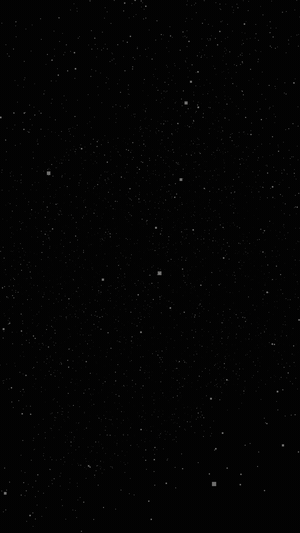&nbsp;
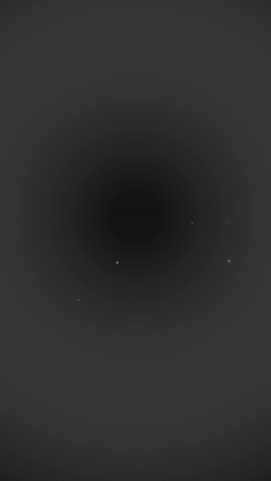&nbsp;
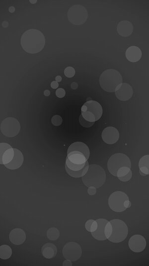&nbsp;
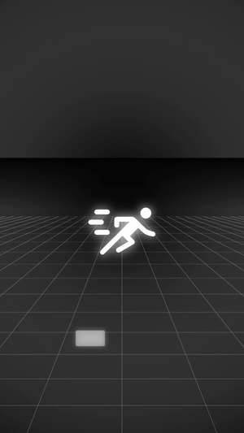&nbsp;
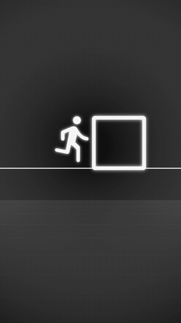&nbsp;
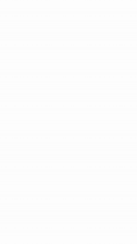

<sub>point cloud · vector motion (destaque, bolhas, grade, objetos) · vitrine</sub>

</div>

| Preset | Estilo | Exemplo |
|---|---|---|
| **VITRINE** ([guia](presets/vitrine/PRESET.md)) | Interface limpa de luxo: cada frase vira interface (conversor que digita, perfil com seguidores subindo, cartão do canal com sino, caixa de seleção, janela de arquivos, pílula de aviso), fundo branco e preto, uma cor de destaque, tudo entrando com desfoque. Gancho com troca a cada 1,2-1,8 s, som de interface em cada movimento |  |
| **POINT CLOUD** ([guia](presets/point-cloud/PRESET.md)) | Milhares de pontos desenham fotos reais (com crédito, domínio público), textos com volume e formas (galáxia, esfera, anel) e migram de uma cena para a outra com câmera 3D. Fundo preto, serifa itálica. Para curiosidade, história, filosofia, ciência e abertura de marca |  |
| **VECTOR MOTION** ([guia](presets/vector-motion/PRESET.md)) | "1 prompt, 1 vídeo": roteiro de 4-6 frases, cada frase vira uma metáfora visual (um entre muitos, multidão, caminho, porta, calendário, cartões de vidro, herói), preto e branco com o protagonista brilhando. 4 estilos: **destaque**, **bolhas**, **grade**, **objetos**. Para frase de efeito, mentalidade, hábito e rotina |  |
| **TELA DIVIDIDA** ([guia](presets/tela-dividida/PRESET.md)) | Reels de talking head com o painel de motion em cima (46,5 %) e você embaixo, legenda em etiqueta branca na emenda e quebras em tela cheia a cada 3-5 s. O Gab enquadra o rosto sozinho no DaVinci. Para vídeo explicativo que cita app, site, número ou passo a passo | 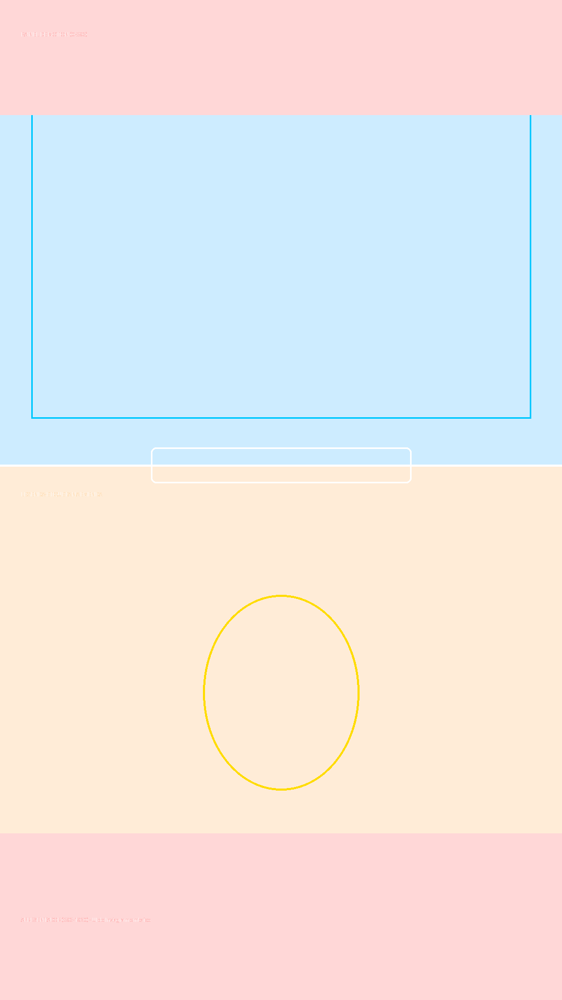 |


# CLIENTES

## Perfil, pronúncia e estilo de edição

Cada empresa tem uma pasta em `clientes/<empresa>/` (local, fora do git), criada na primeira vez a partir de `clientes/_exemplo/`:

| Arquivo | Para quê |
|---|---|
| `empresa.md` | O que faz, público, dores, tom, CTA, cores, fontes e o que **não** dizer |
| `pronuncia.json` | Grafia certa de cada termo, como escrever para a voz e erros de transcrição já vistos. A skill aprende sozinha |
| `estilo.md` | **O estilo de edição da marca**: formato, camadas, presets de lettering, legenda, motions e CTA, b-roll, música aprovada e rejeitada, export e tom. Lido **antes** de editar qualquer vídeo da empresa |

Cada empresa tem o seu estilo. Regra que você dá para uma marca vai para o `estilo.md` dela; regra geral vai para o `SKILL.md`. O estilo também fica espelhado no perfil da empresa no Desktop (`~/Desktop/<empresa>.md`).


# INSTAGRAM

O Gab também é o social media: o vídeo sai pronto e o post sai junto. Basta pedir para o `/ogab`.

<p align="center">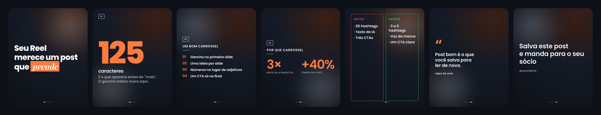<br><sub>Carrossel gerado e exportado sem clique: 7 slides 1080x1350 nas cores e na fonte da marca (aqui, a do próprio Gab).</sub></p>

<p align="center">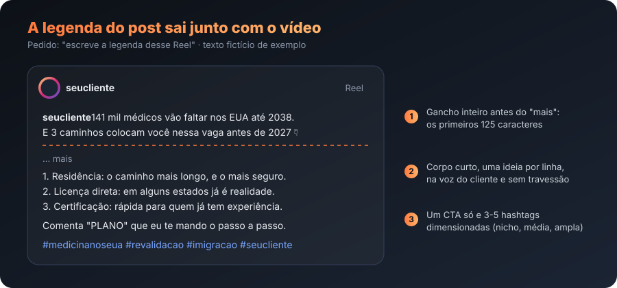</p>

| Peça para o Gab | O que ele faz |
|---|---|
| "escreve a legenda do post desse vídeo" | Gancho nos primeiros 125 caracteres (antes do "mais"), corpo curto, um CTA, 3-5 hashtags, sem cara de IA. Vai para `videos/legenda_post.txt` |
| "monta um carrossel sobre X" | Planeja slide a slide e **gera as imagens prontas** (PNG por slide e PDF para LinkedIn) nas cores e na fonte do cliente: 12 tipos de slide (gancho, lista, números, antes x depois, citação, CTA...) e formatos 4:5, quadrado, Stories e 16:9 |
| "por que esse Reel viralizou?" + link | Extrai e classifica o gancho para você reaproveitar |
| "planeja a semana da Bora Imigrar" | Reels, carrosséis e stories por pilar de conteúdo |
| "transforma esse post do LinkedIn em carrossel" | Adapta conteúdo de outra rede para o formato do Instagram |
| "revisa o perfil" | Foto, nome, bio, link, destaques, primeira grade e fixados |
| "o que está funcionando no meu nicho?" | Lê dados reais de hashtag e de perfis (com token Apify) |

Escreve na língua e na voz do cliente (lê `clientes/<empresa>/empresa.md` e `estilo.md`) e nunca usa travessão.

**Publicar é opcional.** Sem chave nenhuma, tudo funciona em modo rascunho: você copia e posta pelo app. Para o Gab subir a mídia e agendar, copie `instagram/.env.example` para `instagram/.env` (fora do git) e preencha a chave da [Publora](https://publora.com) (conta Business ou Creator). `APIFY_TOKEN` libera a leitura de dados do nicho e `PIXFARO_TOKEN` a geração de imagens. Ele só publica depois do seu "pode postar".


# PASTA DO VÍDEO

```
~/Desktop/<Empresa>/
  marca/                       logos/ identidade.json identidade.md (do site oficial)
  <Assunto> - <Empresa>/
    roteiro.txt  links.txt     (de onde veio cada coisa)
    narracoes/ ou gravacao/    musica/  sfx/  brolls/  motions/  legendas/
    videos/                    <Assunto> - <Empresa>.mp4  capa.png  legenda_post.txt
```

No DaVinci o Media Pool fica em `Timelines / Footages / BRoll / SFX / Musicas / Motions / Legendas`, com subpastas `01`, `02`... quando há mais de um vídeo no projeto.


# LEGENDA

- **Uma linha**, até 25 caracteres, cortada em ponto natural da frase. **Métrica obrigatória** logo depois de gerar: `legendas.py metrica` com 0 problema antes de seguir.
- Preset de trilha **GAB USA** (Poppins Bold, caixa alta).
- Vai do **início ao fim** do vídeo, inclusive no CTA e nos motions. Nunca some.
- Posição padrão **Y 724**; só as legendas que cruzam um lettering, ou um motion na faixa de baixo, descem para **Y 390**. A API do Resolve não mexe em estilo de legenda, então o `legenda_ui.py` faz isso pela interface com OCR, numa chamada só.
- Legendas que faltam se **acrescentam sem apagar** as que já existem: SRT só com as novas, com o tempo contado a partir do fim da última legenda.


# EDITORES E MOTIONS

| | DaVinci Resolve | Adobe Premiere Pro |
|---|---|---|
| Como o Gab controla | API de scripting do Resolve | plugin **Gab Ponte** (painel UXP, uma vez: Window > UXP Plugins > Gab Ponte) |
| Transcrição | do DaVinci (21.1+) | Speech to Text do Premiere |
| Isolar voz | Voice Isolation | Enhance Speech ("Aprimorador de voz") |
| Cor | PowerGrade (.drx) | LUT DO GAB pelo Lumetri |
| Lettering | @gabrielxreis_ Text Presets (.drfx) | MOGRTs da biblioteca |
| Detalhes | [`docs/etapas/`](docs/etapas) | [`premiere/README.md`](premiere/README.md) |

**Motions:** `hyperframes` (automático, em código) ou `aftereffects`: cada motion é montado no After Effects como **camadas nativas** (cada texto, número, check e cor editável, e uma camada CONTROLES que troca as cores da marca do motion inteiro) e entra na timeline como MOV com alfa. O `.aep` fica na pasta do vídeo. Detalhes em [`aftereffects/README.md`](aftereffects/README.md).

# MOTIONS

- Feitos no **HyperFrames**, com as cores, a fonte e a logo da marca, numa trilha `MOTIONS` (exemplos animados [no topo](#readme)).
- **Sempre centralizados**, medidos com `guias.py` (cutaway no centro da tela, imersivo abaixo do queixo). Nada sobre o rosto: se cobriria o rosto, vira tela cheia sobre um BG animado, que fica contínuo entre motions próximos.
- Acabamento caprichado e variado, sem repetir o mesmo layout.
- **Inspiração:** antes de um motion novo, o Gab busca referências de movimento numa coleção de 850+ vídeos feitos em código (`scripts/inspiracao.py`).

## Biblioteca de motions

Modelos prontos em [`biblioteca_motions/`](biblioteca_motions) (cada um com `modelo.json` e `previa.png`): lista com checks, contador com barra, frase em duas linhas... O Gab preenche os campos do vídeo (título, itens, números) e as cores do cliente, e o modelo se ajusta (quantidade de itens, duração, centro da tela). **Cresce a cada vídeo:** todo motion novo aprovado vira modelo e é publicado aqui; você recebe no próximo update. Os modelos também viram **MOGRT** para o Premiere (`scripts/gerar_mogrts.py`, em `premiere/assets/mogrt/`), com texto e cores editáveis no Essential Graphics.

```bash
python3 ~/.claude/skills/ogab/scripts/biblioteca_motions.py listar
```


# ÁUDIO E EXPORT

- Voz com Voice Isolation, música a -10 dB, SFX discretos.
- `renderizar()` exporta com a legenda gravada, **corta no último quadro de vídeo** (nada de quadro preto no fim) e **masteriza** o áudio: loudnorm em duas passagens para **-14 LUFS** com pico de **-1,5 dBTP**, vídeo copiado sem recomprimir. Para com erro se ficar fora do alvo.
- Render Cache fica desligado.


# SCRIPTS

Todos em `scripts/`, rodando com `python3`.

### legendas.py
    rascunho     transcricao.json frases.txt [--cliente pasta] [--max 25]   Uma legenda por linha, cortada em ponto natural
    sincronizar  transcricao.json frases.txt saida.srt                      Casa cada legenda com o tempo das palavras
    metrica      legenda.srt                                                Uma linha, tamanho, fim fraco, duração, sobreposição

### legenda_ui.py
    "<timeline>"                       Trilha em Y 724 e desce para 390 as legendas que cruzam a trilha LETTERING
    "<timeline>" --indices 4,5,6       Escolhe à mão quais descem (1 = primeira legenda)
    "<timeline>" --so-listar           Só mostra a lista
    "<timeline>" --conferir            Render e mede a altura do texto de cada legenda

### guias.py
    guia      [saida.png]                                   Guia 1080x1920: centros, áreas, faixa da legenda, interface do Instagram
    medir     <arquivo.mov|.png> --alvo cutaway|imersivo    Área visível do motion e distância do centro (passa com até 6 px)
    sobrepor  <arquivo> <fundo.png> <saida.png> [--t 2.0]   Prova visual: fundo + motion + guia

### cortes.py
    plano  <transcricao.json> <saida.json> [--tirar "frase"] [--pausa 0.35]   Tira retakes e encurta pausas pela transcrição

### sonorizar.py
Sonoriza cena, take ou animação sem chave de IA: `analisar <video>` (momentos de ação, cortes, pan e folha de quadros), `medir` (ataque e pico de cada som), `mixar <plano.json>` (ambiente, foley e pontuais em camadas, pan, ducking sob a voz, -14 LUFS, stems + prévia) e `davinci` (vira `plano_sfx.txt` editável som a som). Guia: `docs/etapas/sonorizacao.md`.

### baixar_video.py
B-roll de material real, na ordem **buscar > achar > folha > baixar**:

    buscar  "<termos>" [--fonte youtube|commons|nasa] [--tipo video|imagem]   Título, autor, duração, licença e link
    achar   <url> "<frase>"                          Onde o assunto aparece (legenda, capítulos, descrição), com nota
    folha   <url|arquivo> <saida.jpg> --de --ate     Grade de quadros com o tempo, para olhar antes (--varrer: vídeo inteiro)
    baixar  <url> <pasta_brolls> <nome> --de --ate   Só o trecho, H.264 sem áudio, origem e licença no links.txt
    tiktok  @usuario                                 Posts recentes do perfil sem login
    print   <url> <saida.png> --vertical             Print 1080x1920 de site ou notícia

<p align="center">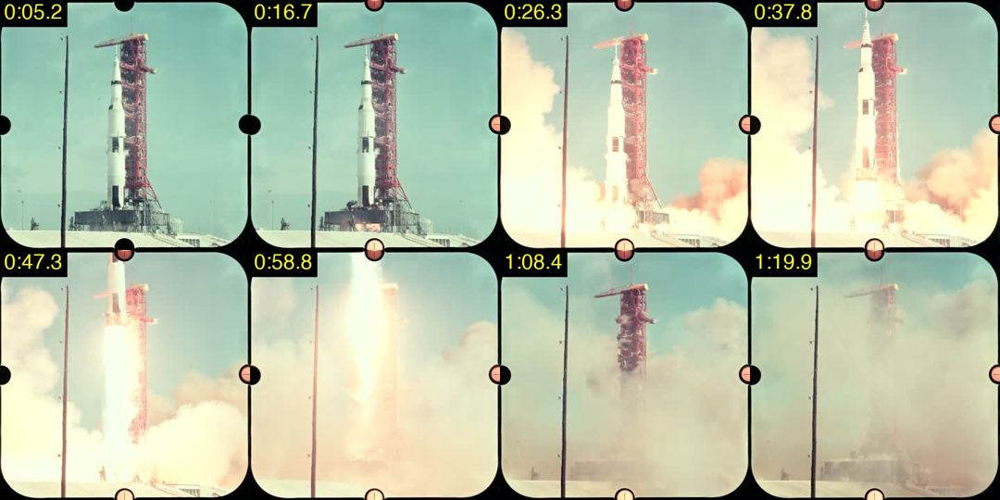<br><sub>Folha de quadros que o Gab confere antes de baixar um b-roll: lançamento da Apollo 11, acervo da NASA (domínio público), achado com <code>buscar --fonte nasa</code>.</sub></p>

### broll.py
Coloca o b-roll pela frase da transcrição, já convertida para o tempo da timeline cortada, na trilha BROLL (clipe bruto com entrada e saída, editável).

### rastrear.py
    <video> --caixa X,Y,L,A | --rosto [--de --ate] [--saida trilha.json]   Trajetória para texto que segue o objeto ou o rosto

### sfx_auto.py / sfx_conferir.py
Efeitos sonoros pelos tempos da timeline (whoosh na entrada dos motions e do b-roll forte, pop no CTA) e conferência sem ouvir (classificador de áudio, densidade, sincronia).

### projeto.py / retrato.py
    projeto.py status|lote|checklist <pasta>   Barra de progresso, PROJETO.md e checklist obrigatório antes de entregar
    retrato.py antes|depois "<timeline>" <pasta>   Fotografa a timeline antes de mexer e compara depois

### tresd/tresd.py
    logo  plano.json saida.mov   Logo ou texto extrudado em metal, MOV ProRes 4444 com alfa (Blender sem janela)
    cena  cena.py saida.mov      Objeto 3D montado por script; o .blend fica ao lado, editável

### qc.py
    <pasta_do_video> [--cliente pasta] [--plataforma instagram|meta_ads|youtube_shorts]
    Estrutura, resolução, duração, quadros pretos, loudness, legenda, grafias erradas, green screen, arquivos pesados

### transcrever.py
    <audio.wav> <saida.json> [--motor auto|davinci|whisper] [--idioma pt]   Tempo por palavra (DaVinci 21.1+ ou Whisper local)
    --versao                                                                 Versão do DaVinci e motor escolhido

### marca.py
    <site> <pasta>/marca     Logos, cores, fontes, favicon e imagem de compartilhamento do site oficial
    inverter <logo.png>      Versão oposta da logo (branca <-> preta), mantendo a transparência

### midia.py
    preparar_take  entrada saida.mp4 [1080x1920]   4K/ProRes pesado para 1080 H.264
    audio48k       entrada saida.wav               Converte para 48 kHz
    green / iphone / info  arquivo                 Green screen, detecção de iPhone, metadados

### pauta.py
    "<tema1>; <tema2>" [--fonte gratis|newsapi|gnews] [--dias 7] [--n 8]   Notícias recentes para virar roteiro

### resolve_lib.py
Biblioteca usada pela skill: projeto, timeline, narração, música, SFX, takes, legenda, lettering, enquadramento, organização do Media Pool, `renderizar()` e `masterizar()`.


# ARMADILHAS CONHECIDAS

Já tratadas pela skill:

- **Frame rate de playback** não muda por script depois que o projeto tem timeline: a skill grava ao criar.
- **Takes 4K/ProRes** travam a reprodução: convertidos para 1080 H.264 antes de importar.
- **Títulos animados** só entram pela API na trilha de destino e empurram o resto: a skill trava as outras trilhas e insere numa camada acima. Cortar título no meio derruba o Resolve; a saída é um fade no bloco. Nunca mexer na animação de entrada do template.
- **Estilo de legenda** não existe na API e o Resolve só grava **uma** trilha de legenda no burn-in: a posição por legenda é feita pela interface (`legenda_ui.py`).
- No `legenda_ui.py`, o Resolve (Qt) **ignora teclado enviado pelo Quartz**: as teclas vão pelo System Events. **Tab** no campo de posição joga o foco no botão "Add New" e o próximo Return cria uma legenda "Subtitle": nunca usar.
- `AppendToTimeline` usa a timeline **aberta** e, para SRT, cola **depois da última legenda** da trilha.
- **Trilha de legenda desligada** rejeita o SRT em silêncio.
- **Música passando do fim** gera quadro preto: o render corta no último quadro de vídeo.
- Conectores de Envato/Artlist/Magnific **não baixam** arquivos: download pelo navegador.
- Gerar no Magnific **pelo MCP cobra crédito**; o ilimitado só vale pelo site.


# ESTRUTURA DO REPOSITÓRIO

```
SKILL.md                 instruções que o Claude segue (o "cérebro" da skill)
README.md                este arquivo
install.sh               instalador de um comando (Mac)
CHANGELOG.md             novidades por versão (o Gab mostra as novas ao abrir)
windows/                 instalador e camada do Windows
premiere/                plugin Gab Ponte, premiere_lib.py, LUT e MOGRTs
aftereffects/            extensão Gab Ponte AE, ae_lib.py e gab_ae.jsx (motions editáveis)
biblioteca_motions/      modelos de motion prontos (modelo.json + previa.png)
config.example.json      modelo de configuração (copie para config.json)
scripts/                 resolve_lib, legendas, legenda_ui, legenda_auto, legenda_baixa, guias, centro, cortes, qc,
                         transcrever, marca, midia, pauta, baixar_video, broll, rastrear, sonorizar, sfx_auto,
                         sfx_conferir, projeto, retrato, doctor, novidades, biblioteca_motions, gerar_mogrts,
                         inspiracao, morph_logo, svg_texto, movimentos.mjs
tresd/                   3D no Blender: logo/texto extrudado e objetos (cenas/)
navegador/downloads.md   como baixar no Envato, Artlist e Magnific pelo Chrome
docs/PROCESSO.md         referência detalhada, armadilhas e decisões
docs/PROVEDORES.md       o que conectar e quanto custa cada etapa
docs/BACKGROUNDS.md      fundos animados para os motions
instagram/               parte de Instagram: 9 especialidades (legenda, carrossel, hashtags, humanizer...), referências e lib de publicação
instagram/carrossel/     gerador de carrossel em imagem (Next.js): carrossel.py novo | previa | exportar
presets/<nome>/           presets de edição e motion (PRESET.md, kit HyperFrames, exemplo)
docs/etapas/              uma instrução por etapa (takes, legenda, sfx, sonorização, tracking, motion avançado...)
clientes/_exemplo/       modelo de empresa.md, pronuncia.json e estilo.md
assets/fontes/           Poppins, Playfair Display, Lobster (OFL)
assets/lettering/        @gabrielxreis_ Text Presets.drfx (29 títulos animados do Fusion)
```


# LICENÇA

Código: [MIT](LICENSE). Fontes em `assets/fontes/`: SIL Open Font License. O pacote de lettering `@gabrielxreis_ Text Presets` (`assets/lettering/`) é de Gabriel Reis, liberado para uso com a skill. Músicas, takes e vozes pertencem às plataformas e aos autores e seguem as licenças das suas assinaturas.

## Skills extras instaladas junto (install.sh, passo 5b)

| O quê | Para quê no Gab |
|---|---|
| `design-taste-frontend` (leonxlnx/taste-skill) | motions, cards, CTA e qualquer peça visual em HTML (HyperFrames) sem cara de template |
| `image-to-code` (leonxlnx/taste-skill) | recriar em código uma referência visual (print de site, cartão, layout) para motion |
| `web-design-guidelines` (vercel-labs/agent-skills) | conferir legibilidade, contraste e acessibilidade dos motions/peças |
| `playwright-cli` (microsoft/playwright-cli) | automação de navegador por linha de comando (capturar página do cliente, prints, rolagem para motion de site) |
| `reverse-engineer-anything` + MCP REA (morluto/rea) | entender como um app/site/efeito funciona (ex.: como um app faz uma animação ou template) para recriar no fluxo |
| `awesome-design-md` (voltagent) | `~/.claude/referencias/awesome-design-md/design-md/<marca>/DESIGN.md`: sistemas visuais de 70+ marcas como referência de estilo |
| `cc-blender-skill` (RobLe3, MIT; passo 3c) | 30 skills `blender-*` (modelagem, materiais, luz, câmera, animação, render) usadas como receita para os **objetos 3D de verdade** (`tresd/tresd.py cena`, exemplo `tresd/cenas/diploma.py`) |
