<!-- PARA O CLAUDE: se o usuário colou este link e pediu para instalar, siga a seção "Instalar pelo Claude" (âncora #instalar-pelo-claude): pergunte no chat, rode o instalador e MOSTRE o progresso ao vivo. -->
<div align="center">

[](#readme)

[](https://github.com/gabrielxreis/ogab/commits/main "Histórico")
[](https://claude.com/claude-code "Claude Code")
[](#requisitos "Requisitos")
[](premiere/README.md "Premiere")
[](capcut/README.md "CapCut")
[](finalcut/README.md "Final Cut Pro")
[](aftereffects/README.md "After Effects")
[](#instalacao "Instalação")
[](windows/README.md "Windows")
[](#requisitos "Requisitos")
[](LICENSE "Licença")

</div>

**/ogab** (o Gab) é uma skill do Claude Code que edita vídeo para redes sociais **no DaVinci Resolve, no Adobe Premiere Pro** (Mac e Windows), **no CapCut** (Mac e Windows, beta) **e no Final Cut Pro** (Mac, beta), com motions automáticos ou montados **no After Effects** em camadas editáveis: do roteiro aprovado até a timeline pronta e o MP4 masterizado, com narração por IA, música, efeitos sonoros, takes de banco ou gerados, lettering animado, motions (HyperFrames), legenda com métrica e conferência automática. Também edita gravações de apresentador (talking head) já abertas no DaVinci (cortes, silêncios, multicâmera de podcast, reenquadramento para vertical) e cuida do **Instagram**: legenda do post, carrossel, hashtags, semana de conteúdo e perfil. A cada marca ele guarda uma **memória** com o que você pediu de diferente, para acertar de primeira no próximo vídeo.

<div align="center">

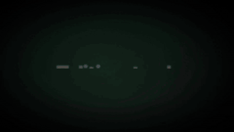

<sub><b>O Gab em 35 segundos:</b> do prompt à timeline pronta no DaVinci, Premiere, CapCut ou Final Cut (vídeo de apresentação feito com a própria /ogab).</sub>

<br>

**Motions que o Gab cria** (HyperFrames, 1080x1920, cores e fonte do cliente)

| Contador | Lista | Lettering | Gráfico | CTA |
|:---:|:---:|:---:|:---:|:---:|
|  |  |  |  |  |

<sub>Exemplos com dados fictícios, na identidade do próprio Gab. Num vídeo de cliente, as cores, a fonte e a logo vêm do site da marca.</sub>

</div>

> **Cada pessoa usa as PRÓPRIAS contas.** A skill não traz conta, chave nem login. Você conecta os seus serviços (ElevenLabs, Artlist, Envato, Magnific...) no seu Claude e faz login nos sites no seu navegador. Nada disso vai para o repositório nem para o `config.json`.

* [NOVIDADES](#novidades)
* [INSTALAÇÃO](#instalacao)
    * [Um comando](#um-comando)
    * [Passo a passo manual](#passo-a-passo-manual)
    * [Atualizar](#atualizar)
    * [Requisitos](#requisitos)
* [USO E COMANDOS](#uso-e-comandos)
    * [Comandos](#comandos)
    * [O fluxo](#o-fluxo)
    * [Editar um vídeo que já está no DaVinci](#editar-um-video-que-ja-esta-no-davinci)
* [COMO O GAB TRABALHA NO DAVINCI](#como-o-gab-trabalha-no-davinci)
* [CONFIGURAÇÃO](#configuracao)
    * [Opções](#opcoes)
    * [Cor e vídeos de iPhone](#cor-e-videos-de-iphone)
* [PRESETS DE EDIÇÃO](#presets-de-edicao)
* [CLIENTES](#clientes)
    * [Perfil, pronúncia e estilo de edição](#perfil-pronuncia-e-estilo-de-edicao)
* [INSTAGRAM](#instagram)
* [VOZ LOCAL (CLONADOR DE VOZ)](#voz-local-clonador-de-voz)
* [PASTA DO VÍDEO](#pasta-do-video)
* [LEGENDA](#legenda)
* [EDITORES E MOTIONS](#editores-e-motions)
* [MOTIONS](#motions)
    * [Biblioteca de motions](#biblioteca-de-motions)
* [ÁUDIO E EXPORT](#audio-e-export)
* [SCRIPTS](#scripts)
* [ARMADILHAS CONHECIDAS](#armadilhas-conhecidas)
* [ESTRUTURA DO REPOSITÓRIO](#estrutura-do-repositorio)
* [LICENÇA](#licenca)


# NOVIDADES

O Gab se atualiza sozinho toda vez que você usa e **mostra o que mudou** logo no começo da conversa. Histórico completo em [`CHANGELOG.md`](CHANGELOG.md). Últimas:

- **Menu do vídeo (`/ogab menu`):** em todo pedido de vídeo o Gab abre um painel com a identidade da /ogab, em português e inglês, um passo por tela: formato por plataforma (Instagram, TikTok, YouTube, Facebook, LinkedIn e Anúncios), quantidade de motion, estilo dos motions com prévias em loop (9:16), gancho, layout, prova, legenda do seu editor ou animada, lettering do seu editor, takes, música, SFX, ritmo, cor e extras. Marque o que quer ou aperte **Automático**; no fim, Confirmar e o Gab recebe na hora. O endereço é sempre o mesmo e a aba aberta se atualiza sozinha.
- **Nova ordem da edição e conferência por quadros:** depois dos cortes vêm lettering e motions, depois música, SFX, takes e cor, e a legenda por último (já desviando dos motions). Antes de renderizar, o Gab mostra uma **folha com os quadros-chave em PNG** exportados direto do DaVinci para você validar; se você apontar um problema, ele confere só aquele trecho (`conferir.py`), sem renderizar o vídeo inteiro de novo.
- **Prévias com gente de verdade:** os presets e estilos do menu mostram cada efeito sobre um vídeo real (banco gratuito, uma pessoa diferente por estilo), nada de personagem desenhado. Dezenas de estilos novos (gancho, legenda animada, layout, prova, batidas, b-roll animado) entram no menu conforme as prévias são aprovadas.
- **Presets da pessoa recortada mais fortes:** **Letreiro** (antigo Palco: palavra gigante atrás da cabeça), **Órbita** (cartões de tamanhos diferentes girando a volta inteira em volta da pessoa, por trás da cabeça e pela frente), **Lente** (zoom que vai certo no rosto) e **Título atrás da cabeça** (a cabeça cobre só a base das letras).
- **Motion atrás da pessoa no próprio DaVinci:** o Gab monta a máscara com o **Magic Mask** no Fusion (seleciona a pessoa com cabelo e o que ela segura, faz o tracking) e deixa a comp na timeline para você ajustar.
- **Presets da comunidade:** o preset que você cria vai inteiro (com tudo que ele precisa para funcionar) para o banco da comunidade e aparece no menu de todo mundo com a prévia.
- **CapCut (Mac e Windows, beta) e Final Cut Pro (Mac, beta):** além do DaVinci e do Premiere, o Gab monta o vídeo no **CapCut** (escreve o rascunho direto, com filtros, adesivos, animações e modelos de texto da loja, e recria no CapCut uma timeline do DaVinci) e no **Final Cut Pro** (gera o projeto FCPXML inteiro: takes, camadas, música, SFX, títulos e legenda no estilo do cliente).
- **Memória da marca:** antes de editar, o Gab cria a pasta e um `<Marca>.md` com o que você pediu de diferente, o que funcionou e o que fazer da próxima vez. Lê tudo antes do próximo vídeo da marca.
- **Silêncios pela transcrição do DaVinci:** corta as pausas entre as palavras que o próprio DaVinci reconheceu (não depende do volume nem do barulho de fundo) e guarda a timeline original como backup.
- **Podcast com 2 câmeras:** multicâmera sincronizado pelo áudio e troca de câmera automática por quem fala. **"Arruma esses aqui":** selecione os clipes no DaVinci e o Gab mexe só neles. **Smart Reframe** para vídeo horizontal em vertical e **estabilização** de take tremido.
- **Lettering editável dentro do DaVinci (beta, OGraf):** a frase de efeito vira um título em HTML que você edita no Inspector (texto, cores, tamanho, posição), sem vídeo renderizado. O Gab pergunta antes de usar.
- **Música medida e mixada melhor:** BPM real, batidas, tom e entrada da batida (`musica.py`); a música abaixa só na faixa da voz e mantém o grave; SFX tonal no tom da música; fades e volume no próprio clipe.
- **Clonador de voz local (opcional, Mac Apple Silicon):** clona a sua voz e gera a narração no próprio Mac, de graça e sem limite, com o motor do VoiceStudio rodando por trás do Claude (sem o app visual). O instalador pergunta uma vez se você quer. Atenção: o motor padrão é **não comercial**; para vídeo de cliente pago, use ElevenLabs ou um motor de licença aberta. Detalhes em [`voz_local/README.md`](voz_local/README.md).
- **Mapa do DaVinci:** engenharia reversa da API do 21.1 (o que dá, o que não dá e as armadilhas conhecidas) em [`docs/etapas/davinci_api.md`](docs/etapas/davinci_api.md).
- **Instagram dentro do Gab:** legenda com gancho nos primeiros 125 caracteres, carrossel slide a slide, gancho de Reel viral, 3-5 hashtags dimensionadas, texto sem cara de IA, semana de conteúdo, perfil e dados do nicho. Publica e agenda pela Publora se você quiser.
- **B-roll real no trecho certo:** o Gab acha onde a pessoa fala o que você pediu (pela legenda, capítulos e descrição do vídeo), olha uma folha de quadros antes de baixar e busca também no acervo da **NASA** e no **Wikimedia Commons** (domínio público, licença anotada). Lista posts de um perfil do **TikTok** sem login e tira **print vertical** de site ou notícia.
- **Sonorização sem chave de IA:** lê o vídeo (o que entra, bate ou para, e de que lado da tela) e monta o som em camadas, com câmera lenta que se ouve, chão e ação certos e cada som conferido por um classificador de áudio.
- **3D de verdade no Blender:** logo e texto extrudados em metal, objetos (diploma, troféu, avião) e morph de formas, com fundo transparente.
- **Tracking:** texto que segue o rosto ou o objeto, no DaVinci, no Premiere e no After Effects.
- **After Effects:** motions em camadas editáveis com glow lines, letter stretch, texto cinético, morphing e câmera 3D.
- **Premiere Pro 2026** como editor (além do DaVinci), **biblioteca de motions** que vira MOGRT, instalador do **Windows** e **doctor** que confere e corrige a instalação.

# INSTALAÇÃO

[](#um-comando)
[](install.sh)
[](https://github.com/heygen-com/hyperframes)
[](docs/PROVEDORES.md)

## Primeiro uso (leia isto)

Depois de instalar, abra o Claude Code e digite **`/ogab comecar`**. O Gab explica em 1 minuto:
- **Como pedir:** `/ogab edita o vídeo X do cliente Y`, `/ogab faz um reels para Y sobre Z`, ou mande o site/briefing de um cliente novo.
- **Onde ele para e espera você:** roteiro, voz, **legenda** (valide antes dos motions: o tempo de tudo depende dela), música.
- **O que você recebe no fim de cada ação:** só uma barrinha (`▰▰▰▱ 4 de 9`, o que falta, o próximo passo).
- **Como gastar menos tokens:** uma conversa por vídeo; para retomar, `/ogab continua o vídeo X` (ele lê o `PROJETO.md` da pasta do vídeo, que guarda status, decisões, arquivos e pendências); peça várias coisas de uma vez; avise quando mexer na timeline.

Guia completo: [`docs/BEM_VINDO.md`](docs/BEM_VINDO.md). O `SKILL.md` é só o mapa; cada etapa tem seu arquivo em `docs/etapas/`, lido só quando chega nela.

## Instalar pelo Claude

**Usuário:** cole o link deste repositório no Claude (app ou Claude Code) e peça *"instala"*. Ele mostra os termos de uso (sem o aceite nada é instalado), pergunta 3 coisas no chat e instala mostrando o progresso: o que está baixando, quantos MB de quanto, a velocidade, o que já estava instalado e o que falta.

**Claude, siga exatamente isto quando alguém pedir para instalar a partir deste link:**
1. **Primeiro os termos:** mostre no chat o resumo dos [termos de uso](docs/TERMOS.md) (licença pessoal; erros e estrutura de motions vão anônimos ao autor; nome é opcional e perguntado à parte) e peça para a pessoa digitar **ACEITO**. Sem isso, PARE: nada é instalado. Nunca aceite por ela.
   **Depois pergunte no chat, de uma vez** (o instalador não consegue perguntar quando você o roda): (a) editor: DaVinci Resolve Studio, Premiere Pro, CapCut (beta) ou Final Cut Pro (beta); (b) motions: automático (HyperFrames) ou After Effects; (c) só em Mac Apple Silicon: clonador de voz local (~5,5 GB, uso não comercial; padrão não).
2. **Mac, app Claude com o painel Terminal** (ferramenta de rodar no Terminal do app): rode lá, numa aba visível, para o usuário ver o painel ao vivo, e acompanhe lendo a aba:
   `OGAB_ACEITO=sim OGAB_EDITOR=davinci OGAB_MOTION=hyperframes OGAB_VOZ_LOCAL=n bash -c "$(curl -fsSL https://raw.githubusercontent.com/gabrielxreis/ogab/main/install.sh)"`
   (troque os valores pelas respostas: editor `davinci|premiere|capcut|finalcut`, motion `hyperframes|aftereffects`, voz `s|n`; `OGAB_ACEITO=sim` só depois do ACEITO da pessoa.)
3. **Sem painel Terminal (Claude Code no terminal):** rode o mesmo comando **em segundo plano**, com a saída num arquivo, e a cada ~20-30 s rode `python3 ~/.claude/skills/ogab/scripts/instalador.py --status` e **cole a saída no chat dentro de um bloco de código** (é o painel: barra, MB, MB/s, prontos, fila). Pare quando ele disser `TERMINOU`. Não fique em silêncio: o usuário quer ver cada etapa.
4. **Se aparecer `PRECISA_DO_USUARIO`:** é o Homebrew, que pede a senha do Mac. Peça para o usuário colar no app Terminal o comando mostrado, digitar a senha e avisar; depois rode o passo 2 ou 3 de novo. Nunca peça a senha no chat. A LUT na pasta do DaVinci também pode pedir senha: se falhar, passe o comando do resumo para o usuário rodar.
5. **No fim:** mostre o resumo (instalados agora, já tinha, o que deu problema com o comando para repetir), o resultado do doctor e o que falta fazer à mão no editor escolhido; diga para reiniciar o Claude e digitar `/ogab comecar`. Log completo: `~/.claude/ogab-instalacao.log`.
6. **Windows:** use o `install.ps1` com as variáveis da seção abaixo e acompanhe o log com `Get-Content $env:TEMP\ogab-install.log -Wait` (o painel ao vivo ainda é só do Mac).

## Um comando

Cole no **Terminal** do Mac:

```bash
curl -fsSL https://raw.githubusercontent.com/gabrielxreis/ogab/main/install.sh | bash
```

O instalador mostra primeiro os [termos de uso](docs/TERMOS.md): sem digitar **ACEITO**, nada é baixado nem instalado.

No **Windows**, no PowerShell (usuário normal):

```powershell
irm https://raw.githubusercontent.com/gabrielxreis/ogab/main/windows/install.ps1 | iex
```

Se baixou o arquivo `install.ps1` em vez de usar o comando acima, rode com `powershell -ExecutionPolicy Bypass -File install.ps1` (o Windows bloqueia script baixado; o Bypass vale só para essa execução, não muda nada no sistema).

**Instalando pelo Claude Code (ou outro terminal sem teclado):** as 3 perguntas do instalador não aparecem; responda antes por variável e acompanhe o log ao vivo em outra aba:
```powershell
$env:OGAB_EDITOR = 'davinci'      # ou premiere, capcut ou nenhum (Final Cut só no Mac)
$env:OGAB_MOTION = 'hyperframes'  # ou aftereffects
$env:OGAB_ACEITO = 'sim'          # só depois que a pessoa digitou ACEITO nos termos
irm https://raw.githubusercontent.com/gabrielxreis/ogab/main/windows/install.ps1 | iex
```
```powershell
Get-Content $env:TEMP\ogab-install.log -Wait
```

O instalador faz **duas perguntas**, que só escolhem qual app o Gab usa (tudo é instalado mesmo assim):
1. **Editor:** DaVinci Resolve, Adobe Premiere Pro, CapCut (Mac e Windows, beta) ou Final Cut Pro (Mac, beta). No Windows: DaVinci, Premiere ou CapCut.
2. **Motions:** automáticos (HyperFrames) ou no After Effects (camadas editáveis).

Trocar depois, sem reinstalar: `/ogab config editor davinci|premiere|capcut|finalcut|nenhum` e `/ogab config motion hyperframes|aftereffects`.

O [install.sh](install.sh) pode ser rodado de novo para atualizar. Ele:
- instala **Homebrew** (se faltar), **ffmpeg**, **yt-dlp**, **Node.js**, **Python 3**, **git** e **Pillow**;
- baixa a skill em `~/.claude/skills/ogab` e cria o seu `config.json`;
- instala o **HyperFrames** e roda o `hyperframes doctor`;
- instala as fontes livres (Poppins, Playfair Display, Lobster, EB Garamond), o **lettering animado** (@gabrielxreis_ Text Presets) e os **títulos OGraf** do Gab no DaVinci;
- confere o **DaVinci Resolve Studio** e o scripting, **detecta a versão** e, abaixo da 21.1, instala o **Whisper local** para a transcrição;
- instala a parte do **Premiere** (plugin Gab Ponte, LUT DO GAB e os MOGRTs da biblioteca) e do **After Effects** (extensão Gab Ponte AE);
- no fim roda o **doctor**, que confere tudo e corrige sozinho o que der, e diz em uma linha o que só você pode fazer.

Depois falta só o que depende de você: ligar o scripting no DaVinci, conectar as suas contas e o Claude in Chrome (passos 5, 8 e 9 abaixo). Reinicie o Claude Code e peça um vídeo.

## Passo a passo manual

1. **HyperFrames** (motions e edição dinâmica):
   ```bash
   npx skills add heygen-com/hyperframes
   ```
2. **Clonar na pasta de skills do Claude:**
   ```bash
   git clone https://github.com/gabrielxreis/ogab ~/.claude/skills/ogab
   ```
3. **Criar a sua configuração** (fica só na sua máquina):
   ```bash
   cp ~/.claude/skills/ogab/config.example.json ~/.claude/skills/ogab/config.json
   ```
4. **Dependências Python:**
   ```bash
   pip3 install pillow pyobjc-framework-Vision
   ```
   O `pyobjc-framework-Vision` é o OCR da Apple usado pelo `legenda_ui.py`.
5. **No DaVinci:** Preferences > System > General > **External scripting using: Local**.
6. **Fontes:** instale as de `assets/fontes/` (licença OFL). O preset de legenda padrão usa **Poppins Bold**.
7. **Lettering animado:** o pacote **@gabrielxreis_ Text Presets** (29 animações: Cinematic, Palavra Por Palavra, Blur Up, Destacado, Zoom Out...) vem em [`assets/lettering/`](assets/lettering) e o instalador já copia para `~/Library/Application Support/Blackmagic Design/DaVinci Resolve/Fusion/Templates/`. Na mão: copie o `.drfx` para essa pasta e **reinicie o Resolve**. Para usar outro pacote, coloque os nomes em `config.json > lettering`.
8. **Conectar as SUAS contas** ([docs/PROVEDORES.md](docs/PROVEDORES.md)): ElevenLabs, Artlist, Envato, Magnific etc. Só o que você usa.
9. **Claude in Chrome:** instale a extensão e faça login nos sites. Downloads são sempre pelo navegador; a IA nunca digita senha.
10. **Acessibilidade:** dê permissão de Acessibilidade ao app que roda o Claude Code (Ajustes do Sistema > Privacidade e Segurança > Acessibilidade). Só é necessário para os ajustes de legenda feitos pela interface.

> **Skill complementar recomendada:** `competitor-profiling` (pacote `anthropic-skills`). Quando você manda o site de uma empresa, a skill usa ela para montar o perfil completo antes de começar.

## Relatos de erro (opcional e anônimo)

Na instalação (ou na primeira vez que o Gab abre) ele pergunta uma vez se pode mandar relatos anônimos dos erros da skill que corrigiu no seu computador. Com "sim", ele envia sozinho em segundo plano: só o erro, a causa e a correção no código da skill (caminhos, nomes, clientes, e-mails e chaves são apagados antes). O Gabriel corrige no repositório e todo mundo recebe no auto-update. Mudar: `/ogab config relatos sim|nao`. Detalhes: `relatos/LEIA.md`.

## Atualizar

A skill faz `git pull` sozinha toda vez que é usada (sem tocar no seu `config.json` nem em `clientes/`) e, se veio coisa nova, **mostra as novidades** antes de seguir. Se o update travar por alguma mudança local sua, o `/ogab doctor` guarda a mudança (sem apagar) e atualiza. Para forçar:

```
/ogab update
```

## Requisitos

| | Mínimo | Observação |
|---|---|---|
| Sistema | macOS ou Windows 10/11 | Testado em Apple Silicon; diferenças do Windows em [`windows/README.md`](windows/README.md) |
| Editor | **DaVinci Resolve Studio 21.1+**, **Adobe Premiere Pro 2026+**, **CapCut 9.4+** (Mac e Windows) ou **Final Cut Pro 12.2+** (Mac) | DaVinci: a versão grátis não tem scripting externo. Premiere: ver [`premiere/README.md`](premiere/README.md). CapCut: grátis serve; efeito "(pro)" só exporta no Pro ([`capcut/README.md`](capcut/README.md)). Final Cut: ver [`finalcut/README.md`](finalcut/README.md) |
| After Effects | 2024+ (só se escolher motions no AE) | Ver [`aftereffects/README.md`](aftereffects/README.md) |
| Python | 3.10+ | Pillow; `pyobjc-framework-Vision` para o `legenda_ui.py` |
| ffmpeg | qualquer recente | Conversão, loudness, master, conferência |
| yt-dlp | qualquer recente (`brew upgrade yt-dlp` se o YouTube mudar) | B-roll de material real: achar e baixar só o trecho de YouTube, TikTok etc. (`baixar_video.py`) |
| Blender | qualquer recente (o instalador instala) | Logo, texto e objetos em 3D (`tresd/`) |
| Google Chrome | qualquer recente | Print de site/notícia (`baixar_video.py print`) e downloads pelo Claude in Chrome |
| Node.js | 18+ | HyperFrames |
| Docker Desktop | **não precisa** | O `hyperframes doctor` avisa "Docker: not found", mas o HyperFrames só usa Docker no render com `--docker`, que o Gab não usa. Pode ignorar |


# USO E COMANDOS

## Comandos

No Claude Code, chame com `/ogab` seguido do pedido, ou só peça em linguagem normal:

| Comando | O que faz |
|---|---|
| `/ogab faz um vídeo para a <empresa> sobre <tema>` | Fluxo completo, do roteiro ao export |
| `/ogab <edição no DaVinci>` | Edita a timeline aberta (cortes, legenda, música, motions, b-roll...) |
| `/ogab menu` | Abre o menu do vídeo para escolher formato, estilos, legenda, música e o resto passo a passo, ou deixar no Automático (abre sozinho em todo pedido de vídeo) |
| `/ogab cliente <nome>` | Cria ou atualiza o perfil do cliente (site, logo, pronúncias, estilo) |
| `/ogab pauta <cliente>` | Busca notícias recentes dos temas do cliente e sugere roteiros |
| `/ogab instagram <pedido>` | Legenda, carrossel, hashtags, semana de posts, perfil (também funciona só pedindo, sem a palavra) |
| `/ogab config <chave> <valor>` | Liga ou desliga opções. Ex.: `config opcoes.multi_formatos true` |
| `/ogab ajuda` | Mostra o que está habilitado e os provedores escolhidos |
| `/ogab doctor` | Confere a instalação inteira, corrige o que der e guia você no resto |
| `/ogab comecar` | Primeiro uso: roda o doctor e explica como pedir |
| `/ogab config editor premiere` | Troca o editor (`davinci`, `premiere`, `capcut`, `finalcut` ou `nenhum`: sem editor, o Gab entrega o MP4 pronto) |
| `/ogab config motion aftereffects` | Troca os motions (`hyperframes` ou `aftereffects`) |
| `/ogab voz-local instalar\|clonar\|motores\|status` | Clonador de voz local opcional: instala, clona a sua voz, lista motores e licenças |
| `/ogab update` | Atualiza a skill |

## O fluxo

<p align="center"></p>

| # | Etapa | Você decide? | Ferramenta |
|---|---|---|---|
| 0 | Pasta do vídeo + **memória da marca** (`<Marca>.md`), lida antes de tudo | - | `projeto.py memoria` |
| 1 | Perfil do cliente + logos e identidade visual baixadas do site | Só na 1ª vez | `competitor-profiling`, `marca.py` |
| 2 | **Menu do vídeo**: formato, estilo dos motions, legenda, lettering, música... ou Automático | **Escolhe** | `menu.py` |
| 3 | **Roteiro** no formato da plataforma (Instagram, YouTube, Meta Ads) | **Aprova** | Pesquisa com fonte e data |
| 4 | **Voz** (narração por IA) | **Escolhe** | ElevenLabs, Artlist ou a sua voz clonada no Mac (`voz_local/`) |
| 5 | Projeto no editor (`Assunto - Empresa`), Media Pool organizado, transcrição e cortes | - | Scripting API, `cortes.py`, `silencios.py` |
| 6 | **Lettering** do pacote do seu editor e **motions** centralizados, medidos na fala, nas cores da marca | Vê a lista | Pacote de títulos, HyperFrames, presets |
| 7 | Música bruta na timeline, -10 dB, fade no clipe; BPM e tom medidos | Escolhe entre 3-4 | Artlist ou Envato, `musica.py` |
| 8 | Efeitos sonoros (foley do que a cena mostra) | Liga/desliga | Biblioteca local, Artlist, Envato, Pixabay |
| 9 | Takes e cor: IA, banco, material real ou misto; LUT da marca | Origem | Envato, Artlist, Pexels / Magnific / YouTube, NASA, Commons (`baixar_video.py`) |
| 10 | **Legenda** de uma linha, métrica obrigatória, já abaixo dos motions | - | `legendas.py`, `legenda_ui.py`, `legenda_baixa.py` |
| 11 | **Validação visual**: folha com os quadros-chave em PNG direto do editor | **Valida** | `conferir.py chave` |
| 12 | Render, **conferência**, **master** e export, capa e texto do post; problema apontado = só aquele trecho | - | `conferir.py trecho`, `qc.py`, `resolve_lib.py` |

<p align="center">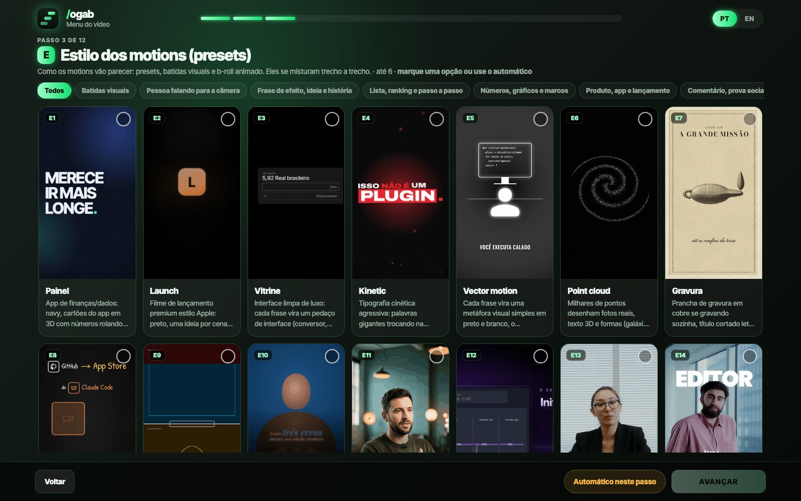<br><sub><b>/ogab menu:</b> um passo por tela, prévias em loop, Automático em cada passo.</sub></p>

## Editar um vídeo que já está no DaVinci

Para gravação de apresentador (talking head), a skill:
- mantém a trilha principal **V1 intocada**: b-roll, lettering, BG e motions entram em camadas acima;
- liga **Voice Isolation** no áudio de iPhone ou câmera;
- enquadra o rosto com o **mínimo de zoom**, sem punch-in alternado; nada sobre o rosto;
- em vídeo emocional, põe **b-roll em toda imagem concreta** e lettering + b-roll nas frases de efeito;
- corta retakes e pausas pela transcrição (`cortes.py`), com a timeline original como backup;
- tira os **silêncios** pelas palavras da transcrição do DaVinci (`silencios.py`), religa o Voice Isolation e para se algum clipe tiver velocidade alterada;
- ordem fixa: **cortes > silêncios > legenda > você valida a legenda > b-roll, lettering e motions**;
- **"arruma esses aqui"**: age só nos clipes que você selecionou na timeline;
- podcast/entrevista com 2+ câmeras: monta o **multicâmera** e troca de câmera por quem fala, e você ainda ajusta o ângulo de qualquer trecho;
- take horizontal em vídeo vertical: pergunta se quer **Smart Reframe** (segue a ação) ou o corte central; take tremido: **estabiliza**.

**Exemplo de conversa:**

```
você: /ogab tira os silêncios da timeline "Depoimento Allan"
Gab:  223,4 s -> 216,2 s (24 silêncios). Original guardada em "Depoimento Allan - com silencios".
      ▰▰▱▱▱▱▱▱▱ 2 de 9 · próximo: legenda

você: (seleciona 3 clipes no DaVinci) arruma esses aqui, estão tremidos
Gab:  Estabilizei os 3 selecionados (o resto da timeline não mudou). Confere na prévia.

você: /ogab monta o podcast com as duas câmeras da pasta gravacao
Gab:  Multicâmera sincronizado pelo áudio, 5 trocas de câmera por quem fala. Troque qualquer trecho no DaVinci.
```


# COMO O GAB TRABALHA NO DAVINCI

O Gab não clica no DaVinci para editar: ele fala com o programa pela **API de scripting** (Python), que o DaVinci Studio abre quando você liga *External scripting = Local*. Só o que não existe na API é feito pela tela, e só com o seu ok.

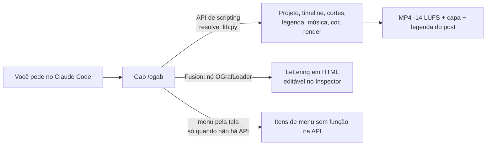

| Pela API (sem clicar) | Só pela tela ou contornando |
|---|---|
| Criar projeto e timeline, importar, montar clipes por trecho, legenda (Create Subtitles from Audio), transcrição palavra por palavra, Voice Isolation, cor (PowerGrade/LUT), render e master | Cortar com blade, aparar ou mover clipe já na timeline: o Gab remonta os trechos numa timeline nova (original vira backup) |
| Volume, pan e fade do clipe de áudio, velocidade do clipe, transições, clipes selecionados por você | EQ, automação e efeitos do Fairlight; cor primária (lift/gamma/gain, curvas) |
| Multicâmera + troca automática por quem fala, Smart Reframe, estabilização, detecção de cortes de cena | Texto e estilo de cada legenda (o Gab usa o preset da trilha e o `legenda_ui.py`) |
| Títulos Fusion do pacote e títulos **OGraf** (HTML) | "Remove Silent Portions" e "Ripple Delete Silence" (o Gab corta pela transcrição) |

O mapa completo, com as funções que o Gab ainda não usa, as escondidas e as **armadilhas** (funções que dizem que funcionaram e não fizeram nada), está em [`docs/etapas/davinci_api.md`](docs/etapas/davinci_api.md). A lista de bugs da API verificados pela comunidade fica em [`docs/referencia/davinci_limitacoes_mcp.md`](docs/referencia/davinci_limitacoes_mcp.md) (do projeto [davinci-resolve-mcp](https://github.com/samuelgursky/davinci-resolve-mcp), MIT).

### Lettering editável (OGraf, beta)

<p align="center">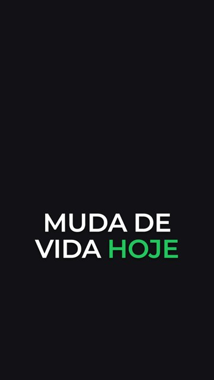<br><sub>Quadro renderizado pelo DaVinci: texto, palavra de destaque, cor, tamanho e posição passados pela API e editáveis no Inspector.</sub></p>

O DaVinci 21 aceita títulos feitos em HTML/JS (padrão OGraf, da EBU). O Gab traz o título **GabLettering** (palavras entrando uma a uma, uma em destaque) em [`ograf/`](ograf) e coloca na timeline pelo nó `OGrafLoader` do Fusion. Antes de usar ele pergunta: *"Quer como título editável no DaVinci (OGraf, beta) ou do jeito padrão?"*. Como criar um template novo: [`ograf/README.md`](ograf/README.md).


# CONFIGURAÇÃO

Tudo em `config.json` (copiado de `config.example.json`, fora do git).

## Opções

| Opção | Padrão | O que faz |
|---|---|---|
| `opcoes.efeitos_sonoros` | `true` | Whoosh nas trocas, impacto no gancho, pop no CTA |
| `opcoes.movimentos_nos_takes` | `perguntar` | Zoom/movimento leve nos takes (`sempre`, `nunca`, `perguntar`) |
| `opcoes.lettering_no_gancho` | `perguntar` | Título animado no começo |
| `opcoes.multi_formatos` | `false` | Renderiza também 4:5, 16:9 e cortes de 15/30/60 s para Ads |
| `opcoes.origem_takes` | `perguntar` | `ia`, `banco` ou `misto` |
| `opcoes.pacote_entrevista` | `perguntar` | Gráficos de entrevista (nome/cargo, números, citações) com `talking-head-recut`; quando e como em `docs/etapas/extras.md` |
| `opcoes.legenda_atras_da_pessoa` | `true` | Legenda atrás da pessoa (`embedded-captions`) no gancho e nas frases de efeito; ver `docs/etapas/extras.md` |
| `opcoes.renderizar_video` | `false` | Exporta o MP4 sozinho (senão entrega a timeline pronta) |
| `opcoes.capa_e_legenda_post` | `true` | `capa.png` e `legenda_post.txt` em `videos/` |
| `opcoes.conferencia_automatica` | `true` | Roda o `qc.py` antes de entregar |
| `opcoes.pauta_automatica.ativo` | `false` | Sugere pautas sozinha (`gratis`, `newsapi` ou `gnews`) |
| `cor.aplicar_power_grade` | `false` | Aplica o seu PowerGrade em todos os takes |
| `regras.volume_db` | narração +5, música -10 | Volumes na timeline |
| `regras.legenda.max_caracteres` | `25` | Tamanho máximo da linha da legenda |
| `regras.geracao_so_ilimitada` | `true` | Nunca gera take que gaste crédito |

## Cor e vídeos de iPhone

- `cor.drx`: PowerGrade padrão, aplicado em todos os takes.
- `cor.drx_iphone`: PowerGrade **combinado** para iPhone (conversor do iPhone primeiro, depois os nós do seu LUT). A skill detecta iPhone sozinha (metadado Apple ou HEVC HLG/Dolby Vision).
- A API não empilha dois PowerGrades no mesmo clipe, por isso o combinado: grave o still na Gallery e exporte (.dpx + .drx) para `assets/grade/`.


# PRESETS DE EDIÇÃO

Estilos completos que você escolhe pelo nome: ritmo, transições, visual, som e um kit de motions pronto. Peça "faz um reels da X **no preset vitrine**" (ou **point cloud**, **vector motion**, **sketch**) ou coloque `preset: <nome>` no `estilo.md` do cliente. **Sem pedir, o Gab escolhe sozinho trecho a trecho** (curiosidade e história em point cloud, frase de efeito em vector motion, coisa de interface em vitrine) e pode misturar no mesmo vídeo.

<div align="center">

**O Gab escolhe sozinho:** pelo pedido e pelo roteiro frase por frase (`scripts/escolher_preset.py`, cérebro em `presets/catalogo.json`), com o porquê de cada escolha. Prefere escolher você? Peça "quero escolher o preset" (`/ogab seletor`): abre uma página com a prévia animada de cada preset e a sugestão do Gab trecho a trecho para você trocar.

&nbsp;
&nbsp;
&nbsp;
&nbsp;
&nbsp;
&nbsp;
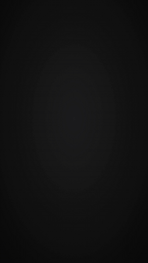&nbsp;
&nbsp;
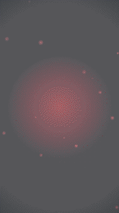&nbsp;
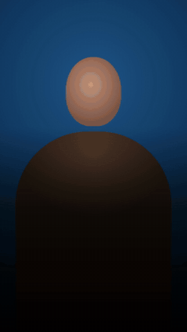&nbsp;
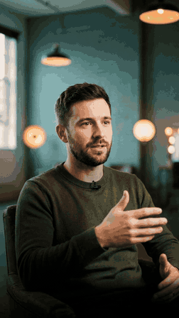&nbsp;
&nbsp;
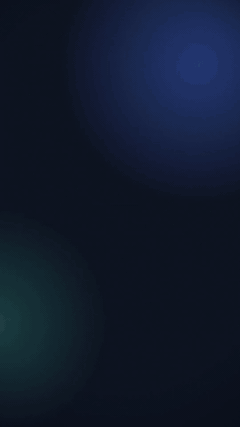&nbsp;
&nbsp;
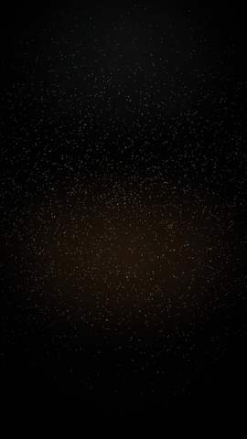&nbsp;
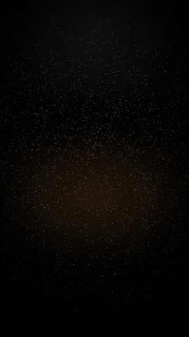&nbsp;
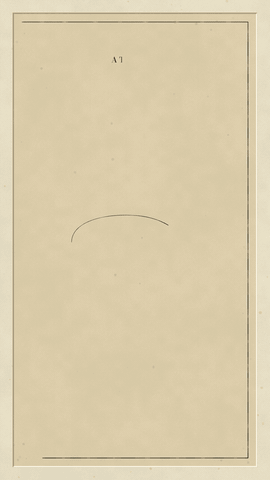&nbsp;
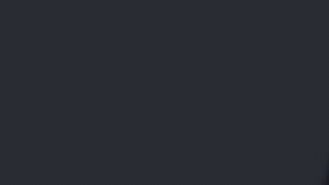

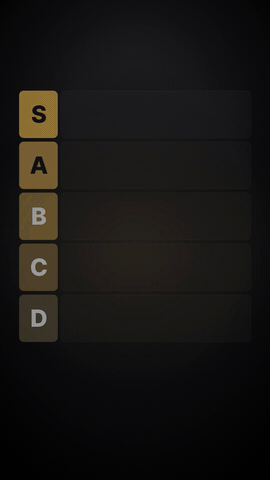&nbsp;
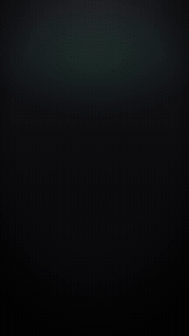&nbsp;
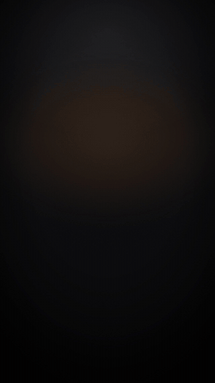&nbsp;
&nbsp;
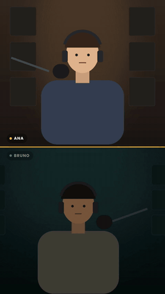

<sub>point cloud · vector motion (destaque, bolhas, grade, objetos) · vitrine · sketch · pessoa recortada (destaque, letreiro, órbita, lente, bancada) · launch · gráfico · marco · logo reveal · gravura · ranking · respostas · comentário · cartões · podcast</sub>

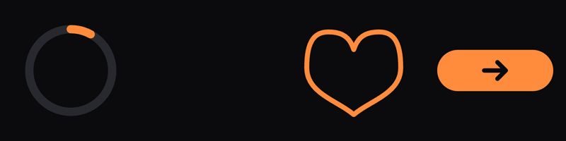

<sub>lottie para site e app: carregando · sucesso · curtir · saiba mais</sub>

</div>

| Preset | Estilo | Exemplo |
|---|---|---|
| **VITRINE** ([guia](presets/vitrine/PRESET.md)) | Interface limpa de luxo: cada frase vira interface (conversor que digita, perfil com seguidores subindo, cartão do canal com sino, caixa de seleção, janela de arquivos, pílula de aviso), fundo branco e preto, uma cor de destaque, tudo entrando com desfoque. Gancho com troca a cada 1,2-1,8 s, som de interface em cada movimento |  |
| **POINT CLOUD** ([guia](presets/point-cloud/PRESET.md)) | Milhares de pontos desenham fotos reais (com crédito, domínio público), textos com volume e formas (galáxia, esfera, anel) e migram de uma cena para a outra com câmera 3D. Fundo preto, serifa itálica. Para curiosidade, história, filosofia, ciência e abertura de marca |  |
| **GRAVURA** ([guia](presets/gravura/PRESET.md)) | Prancha de gravura em cobre que se grava sozinha: o buril corta o contorno, a figura ganha volume em três passadas de hachura, o título em romanas é cortado letra a letra, a nota cursiva é escrita num traço só e a aquarela acende só a parte que importa. Papel antigo, folha nova deitada por cima a cada frase. Para história, fé, tradição e herança de marca (motor do lemo-opuscar, MIT) |  |
| **VECTOR MOTION** ([guia](presets/vector-motion/PRESET.md)) | "1 prompt, 1 vídeo": roteiro de 4-6 frases, cada frase vira uma metáfora visual (um entre muitos, multidão, caminho, porta, calendário, cartões de vidro, herói), preto e branco com o protagonista brilhando. 4 estilos: **destaque**, **bolhas**, **grade**, **objetos**. Para frase de efeito, mentalidade, hábito e rotina |  |
| **SKETCH** ([guia](presets/sketch/PRESET.md)) | Desenho de marcador sobre fundo preto: contornos coloridos que se traçam na hora, cursor piscando, ícones desenhados, texto manuscrito digitado letra a letra, setas que se desenham e o traço "tremendo" como animação feita à mão. Blocos prontos: "A → B", grade de apps com botão, número de capítulo, ferramenta → painel (editor de vídeo, gráfico, lista, chat), frase sublinhada e checklist. Vertical e horizontal. Para tutorial, "X ferramentas que...", passo a passo, tecnologia e IA |  |
| **TELA DIVIDIDA** ([guia](presets/tela-dividida/PRESET.md)) | Reels de talking head com o painel de motion em cima (46,5 %) e você embaixo, legenda em etiqueta branca na emenda e quebras em tela cheia a cada 3-5 s. O Gab enquadra o rosto sozinho no DaVinci. Para vídeo explicativo que cita app, site, número ou passo a passo |  |
| **KINETIC** ([guia](presets/kinetic/PRESET.md)) | Tipografia cinética estilo Katana: cada batida da fala vira uma cena com palavras enormes, hierarquia de tamanhos, ecos em contorno, caixa vermelha, faixa inclinada, prompt digitando, barra de render, ponto de gravação, visor de câmera, cubo 3D e estrela de explosão; fundo preto vivo, vermelho, branco ou grafite e transições de chicote, glitch e risco de luz. Para gancho, reação, frase de efeito e novidade |  |
| **SERIF AZUL** ([guia](presets/serif-azul/PRESET.md)) | Editorial: talking head escuro com legenda em duas fontes (sans pequena + palavra-chave em serifada itálica azul, palavra por palavra), passos 1-2-3 que acendem no vídeo todo, slider "iniciante → profissional" e cenas em papel off-white com grade e luz de janela subindo por cima do apresentador (celular caindo, ícone 3D que encolhe 25 %, amostras de cor, nuvem de marcas, cartões em órbita). Para "3 erros", "5 passos", dica de especialista e marca premium |  |
| **RANKING** ([guia](presets/ranking/PRESET.md)) | Tier list (faixas S a D) ou top 3 que se monta com a fala: cada item cresce no centro, voa até a faixa e fica lá enquanto o próximo é discutido. Para "do pior ao melhor", comparação e veredito |  |
| **RESPOSTAS** ([guia](presets/respostas/PRESET.md)) | Faixa no topo com "?" que vira ícone e palavra no instante da resposta, as anteriores ficam. Para "3 regras para..." e entrevista de rua |  |
| **COMENTÁRIO** ([guia](presets/comentario/PRESET.md)) | Card de comentário de seguidor (claro ou vidro) com @, curtidas contando e a palavra-chave marcada; vários comentários em sequência. Para "respondendo comentário" |  |
| **CARTÕES** ([guia](presets/cartoes/PRESET.md)) | Provas empilhando em profundidade (número, depoimento, print), os anteriores recuam e no fim tudo abre em leque ou grade. Para prova social acumulada |  |
| **PODCAST** ([guia](presets/podcast/PRESET.md)) | Duas pessoas em tela dividida, legenda karaokê na cor de quem fala, abaixo do queixo e acompanhando a cabeça; quem está calado escurece. Só para podcast e entrevista com duas pessoas |  |
| **LUME** ([guia](presets/lume/PRESET.md)) | Estilo "antes e depois" de editor de short-form: legenda em duas camadas (linha pequena fina + palavra-chave grande que brilha em amarelo, letra a letra, num leve ângulo 3D e passando atrás da sua mão), cenas de mesa vista de cima com objetos que nascem desfocados (cérebro, lâmpada, post-it, papéis, tablet), seta tracejada e anotação à mão que se desenham, mergulho de foco e luz vazada quente que esconde o corte para o close. Para bastidor, processo e números de produção |  |
| **DESTAQUE** ([guia](presets/destaque/PRESET.md)) | Legenda palavra por palavra branca e pequena, com a palavra-chave entrando grande em amarelo ou em serifa itálica com brilhinhos girando; às vezes numa pílula branca com marca-texto, ou numa frase empilhada em tamanhos diferentes ("estar / UM PASSO / à frente"). Família CENA | 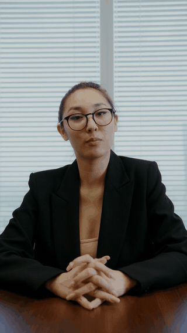 |
| **LETREIRO** ([guia](presets/palco/PRESET.md)) | Palavra gigante ATRÁS da sua cabeça e das mãos: o Gab recorta você do fundo com a segmentação de pessoas da Apple (grátis, no próprio Mac, sem chave de IA) e põe o texto entre o fundo e você. Mede o fundo e usa texto escuro em parede clara. Família CENA. Em todos: nada na frente do rosto (o Gab detecta o rosto, desce a legenda e manda a animação para trás de você) | 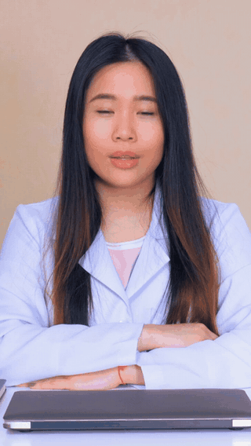 |
| **ÓRBITA** ([guia](presets/orbita/PRESET.md)) | Cartões de vidro em volta de você: cartões de tamanhos diferentes girando a volta inteira ao seu redor (por cima e por trás da cabeça, pela frente abaixo do queixo, sem sumir; com texto ou print de reel), checklist que recebe o check na hora em que você fala cada item, barra "seu reel está pronto 100%" com pílulas, caixa de comentário digitando a palavra do CTA. Família CENA | 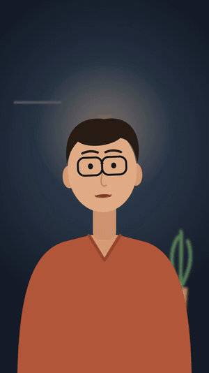 |
| **LENTE** ([guia](presets/lente/PRESET.md)) | Efeitos de câmera no próprio vídeo: zoom rápido no rosto na palavra forte (o recorte acompanha, então o LETREIRO continua atrás). Em seguida: foco de luz, congelar com etiqueta, antes e depois, transição com desfoque e encolher para dentro de uma janela. Família CENA | 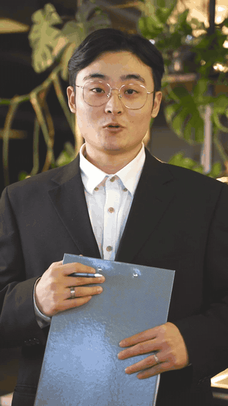 |
| **BANCADA** ([guia](presets/bancada/PRESET.md)) | Em construção: tela verde para comentário, você recortado embaixo, o assunto atrás, gancho fixo no topo e o número circulado à mão. Família CENA | |
| **LAUNCH** ([guia](presets/launch/PRESET.md)) | Filme de lançamento de produto com acabamento premium, na linguagem dos filmes de produto da Apple: fundo preto, uma ideia por cena, frases entrando por máscara com curvas longas que freiam no fim, logo nascendo com contraluz e brilho, o seu site ou app de verdade num painel de vidro flutuando em 3D com reflexo e luz passando, recursos um por vez e fecho limpo. O Gab captura o site sozinho (página inteira, cor da marca). Três letras: **apple**, **editorial** e **cinema**. Para lançar curso, app, SaaS ou site |  |
| **PAINEL** ([guia](presets/painel/PRESET.md)) | Apresentação de app e fintech: fundo navy contínuo com uma cor de destaque, linha de gráfico que se desenha com a ponta acesa, frase empilhada, cartões de interface em 3D com números rolando e câmera que mergulha, disco da cor cobrindo a tela, palavra que nasce do chão e vira gráfico, caos virando grade e fecho com a marca. Para lançamento de app, banco digital, investimento, painel/SaaS |  |
| **GRÁFICO** ([guia](presets/grafico/PRESET.md)) | Dado animado com acabamento premium: barras, linha, rosca ou comparação crescendo com curvas que freiam no fim, o valor EXATO que você aprovou contando até o número certo, um destaque na cor da marca e a fonte do dado sempre na tela (sem fonte, o Gab nem gera). Para "X% dos...", crescimento, ranking, antes e depois |  |
| **MARCO** ([guia](presets/marco/PRESET.md)) | Milhares de pontos girando no escuro se juntam e desenham o seu número ("10 mil alunos", "1 milhão de views", "+10 anos"); o número nítido assenta por cima e a frase sobe. Combina com o POINT CLOUD |  |
| **LOGO REVEAL** ([guia](presets/logo-reveal/PRESET.md)) | Abertura de marca de 5-8 s: fio de luz que se abre e revela o logo, fios que desenham a moldura, ou pontos que se juntam no desenho do logo; contraluz, brilho atravessando e a frase da marca. Para abrir institucional, vinheta e fim de anúncio |  |
| **LOTTIE** ([guia](presets/lottie/PRESET.md)) | Não é vídeo: animações leves para o site ou app do cliente (carregando, sucesso, curtir, botão "saiba mais") em arquivo .json de poucos KB, nas cores da marca, com GIF de prévia |  |
| **GLASS** ([guia](presets/glass/PRESET.md)), da comunidade | YouTube 16:9 premium: vidro escuro com aurora violeta e grão de filme, título metálico, destaque em Playfair itálico e números em Inter fina, revelação por máscara com desfoque. Cenas entram com slide junto com um empurrão de câmera na V1 (no Fusion de cada clipe, reversível), seus prints com anel e caixa marcando o número, stingers de capítulo e cartão de like + inscreva-se com a foto do canal. A cor violeta troca pela da sua marca. Para tutorial e explicativo com webcam e gravação de tela |  |


**Efeitos extras** ([guia](presets/efeitos/EFEITOS.md)), para qualquer motion: física (palavras caindo e empilhando), esfera de "IA pensando", ASCII, lupa e rabiscos à mão.

<p align="center">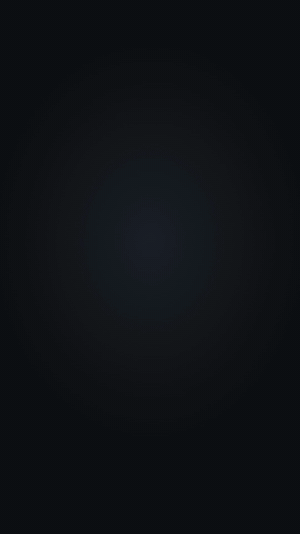&nbsp;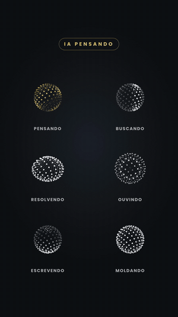&nbsp;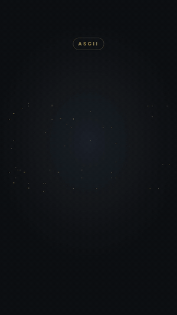&nbsp;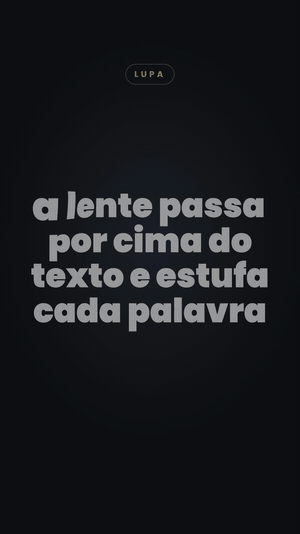&nbsp;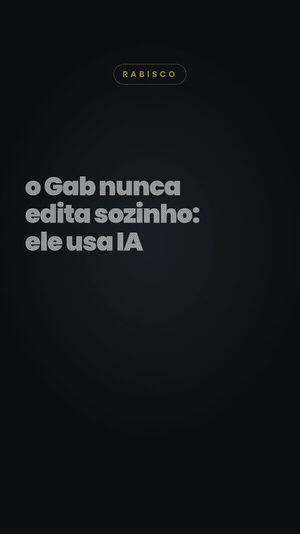</p>

# CLIENTES

## Perfil, pronúncia e estilo de edição

Cada empresa tem uma pasta em `clientes/<empresa>/` (local, fora do git), criada na primeira vez a partir de `clientes/_exemplo/`:

| Arquivo | Para quê |
|---|---|
| `empresa.md` | O que faz, público, dores, tom, CTA, cores, fontes e o que **não** dizer |
| `pronuncia.json` | Grafia certa de cada termo, como escrever para a voz e erros de transcrição já vistos. A skill aprende sozinha |
| `estilo.md` | **O estilo de edição da marca**: formato, camadas, presets de lettering, legenda, motions e CTA, b-roll, música aprovada e rejeitada, export e tom. Lido **antes** de editar qualquer vídeo da empresa |

Cada empresa tem o seu estilo. Regra que você dá para uma marca vai para o `estilo.md` dela; regra geral vai para o `SKILL.md`. O estilo também fica espelhado no perfil da empresa no Desktop (`~/Desktop/<empresa>.md`).


# INSTAGRAM

O Gab também é o social media: o vídeo sai pronto e o post sai junto. Basta pedir para o `/ogab`.

<p align="center">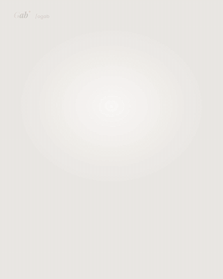<br><sub>Carrossel de motion: cada slide é um vídeo que se monta sozinho (capa, app no celular, CTA).</sub></p>

<p align="center"><br><sub>Carrossel gerado e exportado sem clique: 7 slides 1080x1350 nas cores e na fonte da marca (aqui, a do próprio Gab).</sub></p>

<p align="center"></p>

| Peça para o Gab | O que ele faz |
|---|---|
| "escreve a legenda do post desse vídeo" | Gancho nos primeiros 125 caracteres (antes do "mais"), corpo curto, um CTA, 3-5 hashtags, sem cara de IA. Vai para `videos/legenda_post.txt` |
| "monta um carrossel sobre X" | Planeja slide a slide e **gera as imagens prontas** (PNG por slide e PDF para LinkedIn) nas cores e na fonte do cliente: 12 tipos de slide (gancho, lista, números, antes x depois, citação, CTA...) e formatos 4:5, quadrado, Stories e 16:9 |
| "por que esse Reel viralizou?" + link | Extrai e classifica o gancho para você reaproveitar |
| "planeja a semana da Bora Imigrar" | Reels, carrosséis e stories por pilar de conteúdo |
| "faz um carrossel de motion sobre X" | Cada slide vira um **vídeo 4:5 de 6,5 s que se monta sozinho**: título subindo, celular com o app (números contando, lista recebendo check), cartões ligados por fios, hub de conexão e CTA digitando a palavra. Sai MP4 + PNG por slide, nas cores da marca ([guia](instagram/carrossel_motion/CARROSSEL_MOTION.md)) |
| "transforma esse post do LinkedIn em carrossel" | Adapta conteúdo de outra rede para o formato do Instagram |
| "revisa o perfil" | Foto, nome, bio, link, destaques, primeira grade e fixados |
| "o que está funcionando no meu nicho?" | Lê dados reais de hashtag e de perfis (com token Apify) |

Escreve na língua e na voz do cliente (lê `clientes/<empresa>/empresa.md` e `estilo.md`) e nunca usa travessão.

**Publicar é opcional.** Sem chave nenhuma, tudo funciona em modo rascunho: você copia e posta pelo app. Para o Gab subir a mídia e agendar, copie `instagram/.env.example` para `instagram/.env` (fora do git) e preencha a chave da [Publora](https://publora.com) (conta Business ou Creator). `APIFY_TOKEN` libera a leitura de dados do nicho e `PIXFARO_TOKEN` a geração de imagens. Ele só publica depois do seu "pode postar".


# VOZ LOCAL (CLONADOR DE VOZ)

O Gab pode **clonar a sua voz e narrar os vídeos com ela no próprio Mac**: de graça, sem limite de caracteres e sem mandar seu áudio para nenhum serviço. Por trás, ele usa o motor do [VoiceStudio](https://github.com/debpalash/VoiceStudio) (código aberto) sem o app visual: você só conversa com o Claude.

> **Opcional e com licença a respeitar.** Só instala se você disser sim (o instalador pergunta uma vez; depois, `/ogab voz-local instalar`). O motor padrão (**OmniVoice**) tem licença **não comercial**: serve para os seus vídeos e testes. Para vídeo de cliente pago, use o ElevenLabs ou um dos motores de licença aberta da tabela abaixo. O Gab avisa antes de usar.

**Como funciona**

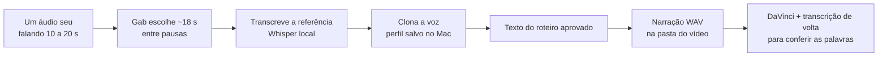

**Na conversa**

```
você: /ogab clona minha voz com o áudio ~/Desktop/eu_falando.m4a, chama de "Gabriel"
Gab:  Referência: 17,8 s (2,1 a 19,9 s do original). Transcrição: "Fala, pessoal, hoje eu vou..."
      Voz "Gabriel" clonada.

você: /ogab faz um reels para a X sobre Y, narra com a minha voz
Gab:  (roteiro para você aprovar)
      Vozes: ElevenLabs (...) · Gabriel (local, grátis, NÃO comercial). Qual?
você: Gabriel
Gab:  Gerando narração ▰▰▰▰▰▰▱▱▱▱ 62%   (a barra aparece ao vivo no terminal do app)
      narracoes/narracao.wav pronta; transcrevi de volta e as palavras batem com o roteiro.
```

| Comando | O que faz |
|---|---|
| `/ogab voz-local instalar` | Baixa o motor (~2 GB) e o modelo padrão OmniVoice (~3,3 GB), pedindo o sim antes de cada download |
| `/ogab clona minha voz` (+ um áudio) | Recorta a melhor janela entre pausas, transcreve e cria o perfil da voz |
| `/ogab voz-local motores` | Lista os motores que falam português: instalado ou não, tamanho, onde roda e licença |
| `/ogab voz-local status` | Mostra se o motor está no ar e as vozes clonadas |

**Motores que clonam e falam português**

| Motor | Roda no Mac | Tamanho | Licença | Destaque |
|---|---|---|---|---|
| `omnivoice` | GPU | 3,3 GB | CC-BY-NC (**não comercial**) | padrão, rápido |
| `voxcpm2` | GPU | ~5 GB | Apache-2.0 | 48 kHz, voz por descrição |
| `confucius4-tts` | CPU | ~5 GB | Apache-2.0 | mantém a voz entre idiomas |
| `moss-tts-nano` | CPU | leve | Apache-2.0 | 48 kHz |
| `pockettts` | CPU | leve | CC-BY-4.0 (aceitar o termo no Hugging Face) | 6 idiomas |

**Para sair bom**
- Mande um trecho **só de voz**, sem música, de 10 a 20 s. O modelo imita o jeito da amostra: um trecho animado gera fala animada, um lido gera fala lida.
- Para pausas naturais, o Gab gera **frase por frase** e junta com silêncio na timeline.
- Seja realista: copia bem o timbre, mas a entonação sai um pouco mais "lida" que no ElevenLabs.
- Requisitos: **Mac Apple Silicon (M1 ou mais novo)**. Windows ainda não.
- Arquivos em `~/Documents/Gab Voz Local/` (referências, áudios gerados, lista de vozes). Detalhes técnicos e armadilhas: [`voz_local/README.md`](voz_local/README.md).


# PASTA DO VÍDEO

```
<pasta_saida>/<Empresa>/      (config.json > pasta_saida; padrão ~/Desktop)
  <Empresa>.md                 memória da marca: pedidos diferentes, o que funcionou, próxima vez, histórico
  marca/                       logos/ identidade.json identidade.md (do site oficial)
  <Assunto> - <Empresa>/
    roteiro.txt  links.txt     (de onde veio cada coisa)
    narracoes/ ou gravacao/    musica/  sfx/  brolls/  motions/  legendas/
    videos/                    <Assunto> - <Empresa>.mp4  capa.png  legenda_post.txt
```

No DaVinci o Media Pool fica em `Timelines / Footages / BRoll / SFX / Musicas / Motions / Legendas`, com subpastas `01`, `02`... quando há mais de um vídeo no projeto.


# LEGENDA

- **Uma linha**, até 25 caracteres, cortada em ponto natural da frase. **Métrica obrigatória** logo depois de gerar: `legendas.py metrica` com 0 problema antes de seguir.
- Preset de trilha **GAB USA** (Poppins Bold, caixa alta).
- Vai do **início ao fim** do vídeo, inclusive no CTA e nos motions. Nunca some.
- Posição padrão **Y 724**; só as legendas que cruzam um lettering, ou um motion na faixa de baixo, descem para **Y 390**. A API do Resolve não mexe em estilo de legenda, então o `legenda_ui.py` faz isso pela interface com OCR, numa chamada só.
- Legendas que faltam se **acrescentam sem apagar** as que já existem: SRT só com as novas, com o tempo contado a partir do fim da última legenda.


# EDITORES E MOTIONS

| | DaVinci Resolve | Adobe Premiere Pro | CapCut (Mac e Windows, beta) | Final Cut Pro (Mac, beta) |
|---|---|---|---|---|
| Como o Gab controla | API de scripting do Resolve | plugin **Gab Ponte** (painel UXP, uma vez: Window > UXP Plugins > Gab Ponte) | escreve o rascunho JSON direto (o CapCut não tem API); você abre o projeto no app | gera o projeto **FCPXML** e o Final Cut importa; ajustes no projeto que já existe, sem recriar |
| Como escolher | `config editor davinci` (padrão) | `config editor premiere` | `config editor capcut` | `config editor finalcut` |
| Transcrição | do DaVinci (21.1+) | Speech to Text do Premiere | do DaVinci ou do `legendas.py` (`.srt`) | do DaVinci ou do `legendas.py` |
| Isolar voz | Voice Isolation | Enhance Speech ("Aprimorador de voz") | efeitos de voz da loja | à mão no Final Cut (Isolamento de voz) |
| Cor | PowerGrade (.drx) | LUT DO GAB pelo Lumetri | filtros da loja do CapCut | à mão no Final Cut (o Gab ainda não automatiza) |
| Lettering e legenda | @gabrielxreis_ Text Presets (.drfx) | MOGRTs da biblioteca | modelos de texto e animação de legenda palavra a palavra da loja | títulos e legenda no estilo medido do cliente (`finalcut/presets/legenda/`) |
| Extra | | | recria no CapCut uma timeline do DaVinci (`davinci_para_capcut.py`); corta silêncio | testado reconstruindo um vídeo de 63 s do DaVinci (24 takes, 18 motions, 44 áudios, 58 legendas) |
| Detalhes | [`docs/etapas/`](docs/etapas) | [`premiere/README.md`](premiere/README.md) | [`capcut/README.md`](capcut/README.md) | [`finalcut/README.md`](finalcut/README.md) |

**Beta:** no CapCut, feche o projeto antes de o Gab gravar (com ele aberto o app sobrescreve tudo) e a 1a abertura precisa de internet para baixar os efeitos da loja. No Final Cut, crie a primeira biblioteca uma vez à mão e deixe aberta (sem biblioteca aberta o app pergunta onde importar).

**Motions:** `hyperframes` (automático, em código) ou `aftereffects`: cada motion é montado no After Effects como **camadas nativas** (cada texto, número, check e cor editável, e uma camada CONTROLES que troca as cores da marca do motion inteiro) e entra na timeline como MOV com alfa. O `.aep` fica na pasta do vídeo. Detalhes em [`aftereffects/README.md`](aftereffects/README.md).

# MOTIONS

- Feitos no **HyperFrames**, com as cores, a fonte e a logo da marca, numa trilha `MOTIONS` (exemplos animados [no topo](#readme)).
- **Sempre centralizados**, medidos com `guias.py` (cutaway no centro da tela, imersivo abaixo do queixo). Nada sobre o rosto: se cobriria o rosto, vira tela cheia sobre um BG animado, que fica contínuo entre motions próximos.
- Acabamento caprichado e variado, sem repetir o mesmo layout.
- **Lettering como título editável no DaVinci (OGraf, beta)**, se você preferir a vídeo renderizado: ver [Como o Gab trabalha no DaVinci](#como-o-gab-trabalha-no-davinci).
- **Inspiração:** antes de um motion novo, o Gab busca referências de movimento numa coleção de 850+ vídeos feitos em código (`scripts/inspiracao.py`).

## Biblioteca de motions

Modelos prontos em [`biblioteca_motions/`](biblioteca_motions) (cada um com `modelo.json` e `previa.png`): lista com checks, contador com barra, frase em duas linhas... O Gab preenche os campos do vídeo (título, itens, números) e as cores do cliente, e o modelo se ajusta (quantidade de itens, duração, centro da tela). **Cresce a cada vídeo:** todo motion novo aprovado vira modelo e é publicado aqui; você recebe no próximo update. Os modelos também viram **MOGRT** para o Premiere (`scripts/gerar_mogrts.py`, em `premiere/assets/mogrt/`), com texto e cores editáveis no Essential Graphics.

```bash
python3 ~/.claude/skills/ogab/scripts/biblioteca_motions.py listar
```

### Banco de presets da comunidade

A biblioteca cresce com quem usa o Gab. Quando você cria um motion novo (um preset a partir de uma referência ou um modelo salvo na biblioteca), o Gab compara com tudo o que já existe. Se for **bem diferente** e você tiver respondido "sim" aos relatos anônimos, ele vai para o Gabriel avaliar só com a estrutura: sem cor da marca, sem texto do cliente, sem nome nem pasta. Os aprovados entram para todo mundo no próximo update, com o selo "comunidade". Uma cópia com outra cor ou outro texto não conta como motion novo.

O banco inteiro, com prévia de cada motion: [`biblioteca_motions/CATALOGO.md`](biblioteca_motions/CATALOGO.md).


# ÁUDIO E EXPORT

- Voz com Voice Isolation, música a -10 dB, SFX discretos.
- **Música bruta** na timeline (o WAV original, cortado no DaVinci), com volume e fades no próprio clipe, conferidos lendo de volta.
- **Música medida antes de cortar na batida:** `musica.py medir` dá o BPM real (o do catálogo erra), o segundo de cada batida, o tom e a entrada da batida. Riser, drone e impacto com nota entram **no tom da música**.
- **Sonorização com a voz na frente:** a música e o ambiente abaixam só na faixa da voz (médio/agudo 12 dB abaixo dela), e o grave desce no máximo 3 dB, então a música não fica magra.
- `renderizar()` exporta com a legenda gravada, **corta no último quadro de vídeo** (nada de quadro preto no fim) e **masteriza** o áudio: loudnorm em duas passagens para **-14 LUFS** com pico de **-1,5 dBTP**, vídeo copiado sem recomprimir. Para com erro se ficar fora do alvo.
- Render Cache fica desligado.


# SCRIPTS

Todos em `scripts/`, rodando com `python3`.

### legendas.py
    rascunho     transcricao.json frases.txt [--cliente pasta] [--max 25]   Uma legenda por linha, cortada em ponto natural
    sincronizar  transcricao.json frases.txt saida.srt                      Casa cada legenda com o tempo das palavras
    metrica      legenda.srt                                                Uma linha, tamanho, fim fraco, duração, sobreposição

### legenda_ui.py
    "<timeline>"                       Trilha em Y 724 e desce para 390 as legendas que cruzam a trilha LETTERING
    "<timeline>" --indices 4,5,6       Escolhe à mão quais descem (1 = primeira legenda)
    "<timeline>" --so-listar           Só mostra a lista
    "<timeline>" --conferir            Render e mede a altura do texto de cada legenda

### guias.py
    guia      [saida.png]                                   Guia 1080x1920: centros, áreas, faixa da legenda, interface do Instagram
    medir     <arquivo.mov|.png> --alvo cutaway|imersivo    Área visível do motion e distância do centro (passa com até 6 px)
    sobrepor  <arquivo> <fundo.png> <saida.png> [--t 2.0]   Prova visual: fundo + motion + guia

### cortes.py
    plano  <transcricao.json> <saida.json> [--tirar "frase"] [--pausa 0.35]   Tira retakes e encurta pausas pela transcrição

### silencios.py
    "<timeline>" [--minimo 0.4] [--pre 0.10] [--pos 0.18] [--simular]   Tira os silêncios pelas palavras da transcrição do DaVinci

### musica.py
    medir <musica.wav> [--bumbo INI FIM] [--de S --ate S]   BPM real, batidas, tom e relativo, afinação e entrada da batida

### sonorizar.py
Sonoriza cena, take ou animação sem chave de IA: `analisar <video>` (momentos de ação, cortes, pan e folha de quadros), `medir` (ataque e pico de cada som), `mixar <plano.json>` (ambiente, foley e pontuais em camadas, pan, ducking sob a voz, -14 LUFS, stems + prévia) e `davinci` (vira `plano_sfx.txt` editável som a som). Guia: `docs/etapas/sonorizacao.md`.

### baixar_video.py
B-roll de material real, na ordem **buscar > achar > folha > baixar**:

    buscar  "<termos>" [--fonte youtube|commons|nasa] [--tipo video|imagem]   Título, autor, duração, licença e link
    achar   <url> "<frase>"                          Onde o assunto aparece (legenda, capítulos, descrição), com nota
    folha   <url|arquivo> <saida.jpg> --de --ate     Grade de quadros com o tempo, para olhar antes (--varrer: vídeo inteiro)
    baixar  <url> <pasta_brolls> <nome> --de --ate   Só o trecho, H.264 sem áudio, origem e licença no links.txt
    tiktok  @usuario                                 Posts recentes do perfil sem login
    print   <url> <saida.png> --vertical             Print 1080x1920 de site ou notícia

<p align="center"><br><sub>Folha de quadros que o Gab confere antes de baixar um b-roll: lançamento da Apollo 11, acervo da NASA (domínio público), achado com <code>buscar --fonte nasa</code>.</sub></p>

### broll.py
Coloca o b-roll pela frase da transcrição, já convertida para o tempo da timeline cortada, na trilha BROLL (clipe bruto com entrada e saída, editável).

### rastrear.py
    <video> --caixa X,Y,L,A | --rosto [--de --ate] [--saida trilha.json]   Trajetória para texto que segue o objeto ou o rosto

### sfx_auto.py / sfx_conferir.py
Efeitos sonoros pelos tempos da timeline (whoosh na entrada dos motions e do b-roll forte, pop no CTA) e conferência sem ouvir (classificador de áudio, densidade, sincronia).

### projeto.py / retrato.py
    projeto.py status|lote|checklist <pasta>   Barra de progresso, PROJETO.md e checklist obrigatório antes de entregar
    projeto.py memoria <pasta_da_marca> ["nota"] --tipo pedido|aprendizado|proxima|feito   Memória da marca
    retrato.py antes|depois "<timeline>" <pasta>   Fotografa a timeline antes de mexer e compara depois

### tresd/tresd.py
    logo  plano.json saida.mov   Logo ou texto extrudado em metal, MOV ProRes 4444 com alfa (Blender sem janela)
    cena  cena.py saida.mov      Objeto 3D montado por script; o .blend fica ao lado, editável

### conferir.py
Conferência visual da timeline por quadros em PNG exportados direto do DaVinci (meia resolução), numa folha com o tempo de cada quadro:
```
python3 scripts/conferir.py chave  [--timeline "<nome>"] [--pasta <saída>] [--max 24]   # cortes, entrada/meio/saída de lettering, motion e b-roll, marcadores
python3 scripts/conferir.py trecho --em 12.5 [--raio 2] [--passo 0.25]                 # só o trecho onde você viu o problema
```

### menu.py
Menu do vídeo (`/ogab menu`): servidor local em `127.0.0.1:47321`, grava `<pasta>/menu_escolha.json` ao confirmar e traz o Claude para a frente com a mensagem pronta para colar.
```
python3 scripts/menu.py --pasta <pasta do vídeo> --cliente <empresa> [--pedido "<pedido>"] [--formato horizontal]
```
Vários vídeos num menu só (cada um com as suas escolhas, ou reaproveitando as de outro): `--video <pasta 1> --video <pasta 2> ...` no lugar de `--pasta`; cada pasta recebe o seu `menu_escolha.json`.

### qc.py
    <pasta_do_video> [--cliente pasta] [--plataforma instagram|meta_ads|youtube_shorts]
    Estrutura, resolução, duração, quadros pretos, loudness, legenda, grafias erradas, green screen, arquivos pesados

### transcrever.py
    <audio.wav> <saida.json> [--motor auto|davinci|whisper] [--idioma pt]   Tempo por palavra (DaVinci 21.1+ ou Whisper local)
    --versao                                                                 Versão do DaVinci e motor escolhido

### marca.py
    <site> <pasta>/marca     Logos, cores, fontes, favicon e imagem de compartilhamento do site oficial
    inverter <logo.png>      Versão oposta da logo (branca <-> preta), mantendo a transparência

### midia.py
    preparar_take  entrada saida.mp4 [1080x1920]   4K/ProRes pesado para 1080 H.264
    audio48k       entrada saida.wav               Converte para 48 kHz
    green / iphone / info  arquivo                 Green screen, detecção de iPhone, metadados

### pauta.py
    "<tema1>; <tema2>" [--fonte gratis|newsapi|gnews] [--dias 7] [--n 8]   Notícias recentes para virar roteiro

### resolve_lib.py
Biblioteca usada pela skill: projeto, timeline, narração, música, SFX, takes, legenda, lettering, enquadramento, organização do Media Pool, `renderizar()` e `masterizar()`. Do DaVinci 21.1: `selecionados()`, `reenquadrar_vertical()`, `estabilizar()`, `multicam_podcast()`, `inserir_ograf_na_trilha()` / `ograf_no_item()` / `conferir_ograf()`.


# ARMADILHAS CONHECIDAS

Já tratadas pela skill:

- **Frame rate de playback** não muda por script depois que o projeto tem timeline: a skill grava ao criar.
- **Takes 4K/ProRes** travam a reprodução: convertidos para 1080 H.264 antes de importar.
- **Títulos animados** só entram pela API na trilha de destino e empurram o resto: a skill trava as outras trilhas e insere numa camada acima. Cortar título no meio derruba o Resolve; a saída é um fade no bloco. Nunca mexer na animação de entrada do template.
- **Estilo de legenda** não existe na API e o Resolve só grava **uma** trilha de legenda no burn-in: a posição por legenda é feita pela interface (`legenda_ui.py`).
- No `legenda_ui.py`, o Resolve (Qt) **ignora teclado enviado pelo Quartz**: as teclas vão pelo System Events. **Tab** no campo de posição joga o foco no botão "Add New" e o próximo Return cria uma legenda "Subtitle": nunca usar.
- `AppendToTimeline` usa a timeline **aberta** e, para SRT, cola **depois da última legenda** da trilha.
- **Trilha de legenda desligada** rejeita o SRT em silêncio.
- **Música passando do fim** gera quadro preto: o render corta no último quadro de vídeo.
- Conectores de Envato/Artlist/Magnific **não baixam** arquivos: download pelo navegador.
- Gerar no Magnific **pelo MCP cobra crédito**; o ilimitado só vale pelo site.
- **`AppendToTimeline` não sobrescreve:** se o lugar já tem clipe, o novo some sem erro, e um append com erro pode sumir no salvar. O Gab confere a contagem depois de salvar e para se a trilha da música já está ocupada.
- **`DeleteClips` só funciona na página Edit** (no Fairlight ou Color devolve falso e não apaga). **Salvar o "Untitled Project"** falha e, sem interface, trava. **Criar projeto** descarta o atual se não estiver salvo. Tudo isso já é tratado no `resolve_lib`.
- **Render do Fusion pela API** (`comp.Render`) abre a janela "Render completed!" e trava a API até alguém clicar OK: o Gab confere pelo render normal do DaVinci.
- **Timecode da câmera:** as palavras da transcrição vêm no timecode da câmera (ex. `06:15:36;24`, drop frame); o Gab desconta o início do clipe.
- **Perguntar se uma função existe** (`hasattr`) na API do DaVinci pode dar sim falso: o Gab confere chamando e lendo de volta.


# ESTRUTURA DO REPOSITÓRIO

```
SKILL.md                 instruções que o Claude segue (o "cérebro" da skill)
README.md                este arquivo
install.sh               instalador de um comando (Mac)
CHANGELOG.md             novidades por versão (o Gab mostra as novas ao abrir)
windows/                 instalador e camada do Windows
premiere/                plugin Gab Ponte, premiere_lib.py, LUT e MOGRTs
aftereffects/            extensão Gab Ponte AE, ae_lib.py e gab_ae.jsx (motions editáveis)
biblioteca_motions/      modelos de motion prontos (modelo.json + previa.png)
config.example.json      modelo de configuração (copie para config.json)
scripts/                 resolve_lib, legendas, legenda_ui, legenda_auto, legenda_baixa, guias, centro, cortes, qc,
                         transcrever, marca, midia, pauta, baixar_video, broll, rastrear, sonorizar, sfx_auto,
                         sfx_conferir, projeto, retrato, doctor, novidades, biblioteca_motions, gerar_mogrts, silencios, musica,
                         inspiracao, morph_logo, svg_texto, movimentos.mjs
tresd/                   3D no Blender: logo/texto extrudado e objetos (cenas/); bancos3d.py acha e baixa objeto grátis
voz_local/               clonador de voz local opcional (motor do VoiceStudio, sem o app): voz.py, voicestudio.sh
ograf/                   títulos OGraf (HTML editável no DaVinci): GabLettering + README de como criar
capcut/                  CapCut (Mac e Windows, beta): escreve o rascunho do projeto e recria timeline do DaVinci
finalcut/                Final Cut Pro (Mac, beta): gerador FCPXML, acessibilidade e engenharia reversa
navegador/downloads.md   como baixar no Envato, Artlist e Magnific pelo Chrome
docs/PROCESSO.md         referência detalhada, armadilhas e decisões
docs/PROVEDORES.md       o que conectar e quanto custa cada etapa
docs/BACKGROUNDS.md      fundos animados para os motions
docs/BANCOS_3D.md        bancos de objetos 3D grátis (ordem de busca e licenças)
instagram/               parte de Instagram: 9 especialidades (legenda, carrossel, hashtags, humanizer...), referências e lib de publicação
instagram/carrossel/     gerador de carrossel em imagem (Next.js): carrossel.py novo | previa | exportar
instagram/carrossel_motion/  carrossel em vídeo (HyperFrames): gerar.py plano.json <saída> -> MP4 + PNG por slide
presets/<nome>/           presets de edição e motion (PRESET.md, kit HyperFrames, exemplo)
docs/etapas/              uma instrução por etapa (takes, legenda, sfx, sonorização, tracking, motion avançado, davinci_api...)
docs/referencia/          bugs verificados da API do DaVinci (do davinci-resolve-mcp, MIT)
clientes/_exemplo/       modelo de empresa.md, pronuncia.json e estilo.md
assets/fontes/           Poppins, Playfair Display, Lobster, EB Garamond (OFL)
assets/lettering/        @gabrielxreis_ Text Presets.drfx (29 títulos animados do Fusion)
```


# LICENÇA

Código: [MIT](LICENSE). Fontes em `assets/fontes/`: SIL Open Font License. O pacote de lettering `@gabrielxreis_ Text Presets` (`assets/lettering/`) é de Gabriel Reis, liberado para uso com a skill. Músicas, takes e vozes pertencem às plataformas e aos autores e seguem as licenças das suas assinaturas. O clonador de voz local usa o motor do [VoiceStudio](https://github.com/debpalash/VoiceStudio) (AGPL-3.0), baixado só se você aceitar; o modelo padrão (OmniVoice) é CC-BY-NC, não comercial. A lista de bugs da API do DaVinci em `docs/referencia/` vem do [davinci-resolve-mcp](https://github.com/samuelgursky/davinci-resolve-mcp) (MIT, com o aviso de copyright no topo do arquivo).

## Skills extras instaladas junto (install.sh, passo 5b)

| O quê | Para quê no Gab |
|---|---|
| `design-taste-frontend` (leonxlnx/taste-skill) | motions, cards, CTA e qualquer peça visual em HTML (HyperFrames) sem cara de template |
| `image-to-code` (leonxlnx/taste-skill) | recriar em código uma referência visual (print de site, cartão, layout) para motion |
| `web-design-guidelines` (vercel-labs/agent-skills) | conferir legibilidade, contraste e acessibilidade dos motions/peças |
| `playwright-cli` (microsoft/playwright-cli) | automação de navegador por linha de comando (capturar página do cliente, prints, rolagem para motion de site) |
| `reverse-engineer-anything` + MCP REA (morluto/rea) | entender como um app/site/efeito funciona (ex.: como um app faz uma animação ou template) para recriar no fluxo |
| `awesome-design-md` (voltagent) | `~/.claude/referencias/awesome-design-md/design-md/<marca>/DESIGN.md`: sistemas visuais de 70+ marcas como referência de estilo |
| `cc-blender-skill` (RobLe3, MIT; passo 3c) | 30 skills `blender-*` (modelagem, materiais, luz, câmera, animação, render) usadas como receita para os **objetos 3D de verdade** (`tresd/tresd.py cena`, exemplo `tresd/cenas/diploma.py`) |
