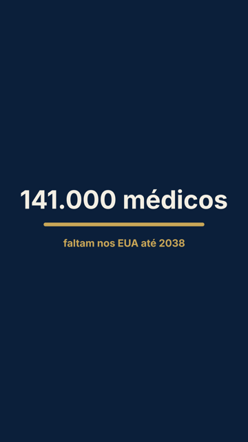
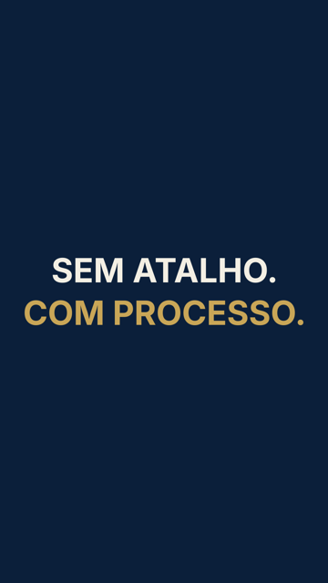
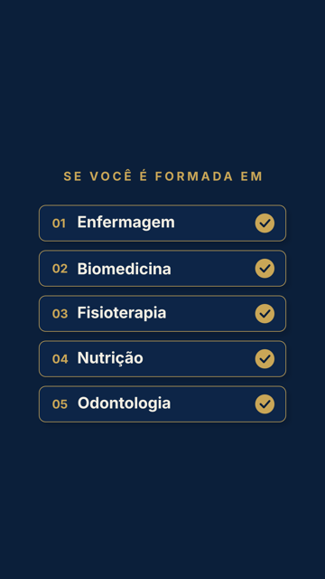

# Banco de presets do Gab

Todo motion que o Gab sabe fazer: os presets da skill (`presets/`) e os modelos da biblioteca (`biblioteca_motions/`), incluindo os que vieram da comunidade. Quem usa o Gab e cria um motion bem diferente destes pode mandar (anônimo, com consentimento) e, se for aprovado, ele entra aqui para todo mundo no próximo update. Arquivo gerado por `scripts/banco_presets.py catalogo`.

## Presets da skill (27)

| Preset | O que faz | Prévia |
| --- | --- | --- |
| [bancada](../presets/bancada/) | Família CENA (motor em `presets/cena`). Em construção (fase 2). |  |
| [cartoes](../presets/cartoes/) | Cartões de prova empilhando em profundidade: cada novo cartão (número, depoimento, print ou foto) entra pela frente e assenta em perspectiva, e os anteriores recuam... |  |
| [cena](../presets/cena/) | Família estudada em 16/10/2026 (página "Claude Creator Studio" + 6 reels do mesmo criador, ver `REFERENCIA.md`): o apresentador falando no centro e tudo acontecendo em... |  |
| [comentario](../presets/comentario/) | O card do comentário de um seguidor entra na tela com um pop suave: escala, leve giro e inclinação em perspectiva que assentam com um overshoot pequeno. O coração enche,... |  |
| [destaque](../presets/destaque/) | Família CENA (motor em `presets/cena`, ver `cena/LEIA.md`). Legenda sempre presente, frase curta (até 3 palavras por grupo, quebra em pausa e pontuação, nunca no meio de... |  |
| [efeitos](../presets/efeitos/) | Avaliados em 16/10/2026 a partir da lista "Claude Motion Tips" (withian.notion.site). Só entrou o que o Gab ainda não tinha; Anime.js ficou de fora (o GSAP já faz) e... |  |
| [glass](../presets/glass/) | Enviado pela comunidade em 15/10/2026 (nome original: vidro violeta). Ao entrar na skill: `\b` da troca de cor (`cor`) consertado (tinha virado um caractere de... |  |
| [grafico](../presets/grafico/) | Barras, linha, rosca ou comparação com o **valor exato** que o cliente aprovou e a **fonte do dado sempre na tela**. O acabamento é o do launch: preto, uma cor de... |  |
| [gravura](../presets/gravura/) | Cada frase vira uma **prancha de gravura antiga** que se grava na frente da pessoa: o buril corta o contorno, a forma ganha volume em três passadas de hachura (contorno,... |  |
| [kinetic](../presets/kinetic/) | Cada batida da fala vira uma CENA curta (0,4-2 s) com palavras ENORMES numa grotesca larga e pesada (Archivo 900, largura 125), trocando no ritmo da voz. O que faz o... |  |
| [launch](../presets/launch/) | Vídeo curto (12-25 s) que apresenta um produto digital (site, app, SaaS, curso) com as telas reais dele. O ponto de partida foi o... |  |
| [lente](../presets/lente/) | Família CENA (motor em `presets/cena`). Mexe no próprio vídeo (e no recorte junto, para o PALCO continuar atrás). |  |
| [logo-reveal](../presets/logo-reveal/) | Abertura de marca de 5-8 s, com o acabamento premium do launch. Serve para início de vídeo institucional, vinheta de canal ou fim de anúncio. |  |
| [lottie](../presets/lottie/) | Animações de interface em arquivo `.json` leve (1-8 KB) que tocam em qualquer tamanho sem perder qualidade. Funcionam em site (lottie-web, `<lottie-player>`), Webflow,... |  |
| [lume](../presets/lume/) | Talking head com cor teal e laranja, vinheta escura embaixo e uma legenda em duas camadas: uma **linha pequena e fina** com a fala e a **palavra-chave grande que... |  |
| [marco](../presets/marco/) | Milhares de pontos girando num campo escuro se juntam e desenham o número do marco ("10 mil alunos", "1 milhão de views", "+10 anos"). Em seguida, o número nítido... |  |
| [orbita](../presets/orbita/) | Família CENA (motor em `presets/cena`). Cartões de vidro escuro (borda clara, cantos 30 px) flutuando em volta dele, amarelo como destaque. Ficam na camada da frente... |  |
| [palco](../presets/palco/) | Família CENA (motor em `presets/cena`). A palavra dita aparece GIGANTE atrás da cabeça e das mãos dele: a pessoa é recortada do fundo (`cena/recorte.py`, segmentação da... |  |
| [podcast](../presets/podcast/) | Corte de podcast ou entrevista com DUAS pessoas: uma em cima, outra embaixo (1080x960 cada), com uma emenda fina na cor da marca. A legenda é karaokê por palavra: cada... |  |
| [point-cloud](../presets/point-cloud/) | Milhares de pontos claros sobre fundo preto desenham fotos reais, textos com volume e formas, e **migram de uma cena para a outra** enquanto a câmera gira em 3D.... |  |
| [ranking](../presets/ranking/) | Um quadro de ranking vai se montando enquanto a pessoa fala. Em `tier`, as faixas S, A, B, C e D (tons da cor da marca) já estão na tela e cada item, no instante em que... |  |
| [respostas](../presets/respostas/) | Faixa no topo do quadro para entrevista de rua, "3 regras para...", "o que você levaria?". N espaços começam com "?" (respirando de leve) e cada um vira ícone + palavra... |  |
| [serif-azul](../presets/serif-azul/) | Talking head escuro com a legenda em duas fontes (sans pequena + palavra-chave em **serifada itálica azul**, 2,2x maior), um contador de passos 1-2-3 que acompanha o... |  |
| [sketch](../presets/sketch/) | Estudado quadro a quadro de um reel de tutorial de apps (13/10/2026): **fundo preto com luz suave no centro e tudo desenhado como se fosse marcador**. Os contornos se... |  |
| [tela-dividida](../presets/tela-dividida/) | Estudado em 13/10/2026 a partir das aulas "Edição Braba com IA" (Edições 01 a 04 e os dois antes/depois). Os vídeos de referência ficam só na máquina... |  |
| [vector-motion](../presets/vector-motion/) | Réplica do processo dos 5 vídeos "1 prompt · 1 vídeo" da página "O Minimalista com IA" (estudados quadro a quadro em 13/10/2026): **roteiro curto de 4-6 frases; cada... |  |
| [vitrine](../presets/vitrine/) | Estilo "interface limpa de luxo": cada frase vira um pedaço de interface (conversor, perfil, cartão, janela, pílula), fundo branco ou preto, uma única cor de destaque,... |  |

## Biblioteca de modelos (3)

| Modelo | Motor | Autor | O que faz | Prévia |
| --- | --- | --- | --- | --- |
| [contador-barra](contador-barra/) | After Effects | gabrielxreis | Número grande que sobe até o valor (com separador de milhar), legenda curta embaixo e barra que enche junto. Bom para dados, estatísticas, salários, vagas. |  |
| [frase-duas-linhas](frase-duas-linhas/) | After Effects | gabrielxreis | Frase de efeito em duas linhas: a primeira entra palavra por palavra, a segunda (destaque) sai do desfoque. Bom para gancho, virada e fechamento. |  |
| [lista-checks](lista-checks/) | After Effects | gabrielxreis | Título pequeno em serifa espaçada, divisor dourado com losango e itens em cartões de vidro entrando alternados (esquerda/direita), cada um com brilho que atravessa e... |  |

Total: 30 motions (0 da comunidade).
