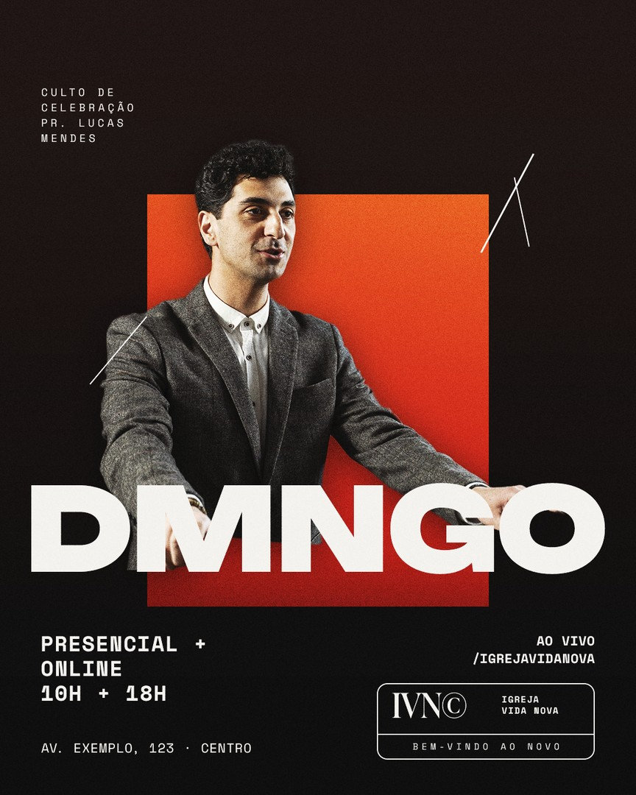

# Preset de estilo: igreja moderna (estilo "rede de igrejas contemporânea")

Post de culto de domingo, conferência, aniversário de igreja, inauguração e virada de ano, no estilo das redes de igrejas contemporâneas brasileiras (Lagoinha e parecidas). Aprendido em 16/10/2026 por engenharia reversa visual de 9 posts publicados (sem PSD). Complementa o [`igreja-culto`](../igreja-culto/README.md), que é o estilo "flyer gospel" de template.

**Diferença para o igreja-culto:** menos efeito de luz e brilho, mais **design editorial**: tipografia grande e ousada, colagem, molduras, textura de papel, rabiscos à mão, fonte mono de máquina de escrever. Parece pôster de festival/marca de moda, não flyer.

## DNA comum (aparece em quase todos)

1. **Palavra-título curta e gigante, ocupando a largura toda:** "DOMINGO", ou a versão sem vogais **"DMNGO" / "DMNG"** (marca registrada do estilo). Fica ATRÁS ou NA FRENTE do pregador, nunca num canto.
2. **Pregador recortado, sorrindo, com microfone**, sempre maior que tudo e "saindo" da moldura (corpo passa por cima da borda do retângulo/arco).
3. **Texto de serviço em fonte mono** (tipo máquina de escrever), caixa alta, tracking largo: "PRESENCIAL + ONLINE / 10H + 18H", endereço com travessão curto ("AV. TAMBORÉ 74 , ALPHAVILLE").
4. **Rabiscos e traços feitos à mão** (linhas finas brancas, zigue-zague amarelo, espirais) por cima e por baixo da pessoa: dá energia e "feito à mão".
5. **Textura de papel/poeira/grão** no fundo inteiro, mesmo nas peças escuras.
6. **Assinatura institucional:** caixa de logo com contorno arredondado + slogan pequeno ("WELCOME TO THE NEW", "BEM-VINDO AO NOVO"), logo da igreja pequeno no topo ou rodapé, ícone redondo da pomba.
7. **Pílulas e caixas de contorno fino** para horários e datas (contorno, não preenchimento).
8. **Troca de letra no título** por outra fonte: script laranja no meio de uma condensada ("I**n**AUGURAÇÃO OFI**c**IAL"), barra no lugar do I ("LAGO/NHA"), O preenchido ("C**O**nf"), script por cima da condensada ("ALPHA" + "Alpha" em script rosa).

## Arquétipos de layout

### A. Moldura quebrada (1 pregador)
Fundo escuro texturizado OU cor chapada. Um **retângulo com degradê quente** (laranja→vermelho) ou um **arco** com foto P&B da plateia; o pregador recortado na frente, ultrapassando a moldura em cima e dos lados. Título gigante (grotesca **expandida** branca ou serifa de alto contraste creme) cruzando o peito. Informações em mono nos cantos. Variante "Matriz": fundo laranja com **padrão geométrico** (losangos e triângulos em 4-5 tons terrosos + azul), texto curvo acompanhando o arco, pomba ilustrada em azul.

### B. Colagem maximalista (conferência, 2-4 pessoas)
Fundo azul/roxo com textura de **glitch/scanline**; letras gigantes pretas cortadas pela borda ("USA"); blocos de foto em cores chapadas (vermelho, amarelo) com cada pessoa num bloco; listras pretas e brancas; estrela branca; rabiscos amarelos; título vermelho condensado com letras trocadas; data condensada itálica; endereço numa barra branca com etiqueta vermelha. Variante clara: fundo **creme papel**, retângulos com **textura de folha de ouro** atrás das pessoas, faixa preta com o título branco, frase repetida empilhada em dourado ("SUNDAY AT LAGOINHA" x3), selo circular de contorno dourado.

### C. Palavra gigante + 2 pregadores (culto com horários)
Fundo preto; foto de plateia/palco no topo, fundindo para o preto; "DOMINGO" condensado enorme em azul **com leve desfoque/glow**; os dois pregadores recortados NA FRENTE do título (cobrem a base das letras); nome de cada um com cantoneiras finas; horário de cada um numa **pílula de contorno azul** embaixo dele; pinceladas azuis e traços brancos nos cantos; linha de logos no rodapé; endereço entre cantoneiras.

### D. Line-up em pirâmide (aniversário, conferência, inauguração)
Muitas pessoas recortadas (5 a 20) montadas em **fileiras escalonadas**, a principal no centro e na frente, as outras atrás e menores. Fundo de palco com luzes (azul-petróleo) ou degradê roxo/magenta com confete. Título à direita (horizontal) ou embaixo (vertical); nomes do line-up em linha condensada no topo; data em caixa de contorno com serifa.

### E. Raios de cor (evento de massa, virada)
Fundo com **raios coloridos em leque** (verde, amarelo, azul, roxo, arco-íris) saindo de trás do título, foto do estádio no topo, fogos, casal/cantores recortados no centro, título branco ultra-bold com número pequeno ("VIRA 26"), selo "AO VIVO PELO" + logo da emissora, URL em pílula.

## Tipografia (identificada pelo desenho; alternativas livres)

| Papel | Desenho | Alternativa gratuita |
|---|---|---|
| Título expandido ("DMNGO") | grotesca extra-larga e pesada | **Archivo Expanded ExtraBold** (eixo de largura), Unbounded Black |
| Título condensado ("DOMINGO", "INAUGURAÇÃO") | grotesca condensada alta | **Anton**, Bebas Neue, Oswald Bold |
| Serifa de alto contraste ("DMNG", datas) | didone/display | **Bodoni Moda**, Gloock, Playfair Display |
| Letra trocada / sobreposta | script pincelado | **Mrs Saint Delafield**, Great Vibes, Yellowtail |
| Serviço, horários, endereço | **mono** máquina de escrever, caixa alta, tracking 100-200 | **Space Mono**, IBM Plex Mono, Courier Prime |
| Apoio | grotesca neutra | Inter, Poppins |

## Paletas vistas

- Preto + laranja/vermelho em degradê + branco (A escuro).
- Laranja terroso + creme + azul petróleo + vermelho tijolo (A Matriz).
- Azul elétrico/roxo + vermelho + amarelo + preto e branco (B).
- Creme papel + dourado folha + preto (B claro).
- Preto + azul ciano (C).
- Roxo/magenta + rosa (D).
- Navy + arco-íris / verde + amarelo + azul (E).

## Árvore (aplicando o método do Rick)

```
ACABAMENTO   textura de papel/poeira (Multiplicação ou Tela), grão, LUT leve
MARCA        logo da igreja, caixa "WELCOME TO THE NEW", ícone da pomba, logos parceiros
RABISCOS     traços à mão (caminhos vetoriais com traçado ou PNG), pinceladas
SERVICO      textos mono (horário, endereço, online), pílulas de contorno, cantoneiras
TITULO       palavra gigante (ATRÁS ou NA FRENTE das pessoas), letras trocadas em script
PESSOAS      recortes (smart objects com máscara), sombra suave, a principal por último (na frente)
MOLDURA      retângulo com degradê / arco com foto P&B / blocos de cor / folha de ouro
FUNDO        cor chapada, padrão geométrico, glitch, raios, ou foto de palco escurecida
```

## Receita (arquétipo A, feed 1080x1350)

1. Pedir: palavra do título (ou usar "DMNGO"), horários, endereço, link online, pregador (foto boa para recortar, sorrindo, com microfone), cores da igreja.
2. Fundo preto + textura de papel em Tela 20-40%.
3. Moldura: retângulo ~60% da largura, alto, com degradê laranja→vermelho e foto da plateia em Luz suave dentro.
4. Pregador: smart object, Selecionar assunto, máscara; posicionar para a cabeça passar da borda de cima da moldura e os ombros passarem dos lados.
5. Título expandido branco, 100% da largura menos margem, cruzando o peito (na frente da pessoa).
6. Mono: bloco de serviço à esquerda, link à direita com ícone, endereço embaixo; crédito vertical/empilhado no canto superior ("ESPECIAL / ANIVERSÁRIO / PR. NOME").
7. Rabiscos brancos finos em 2-3 pontos; caixa de logo com contorno arredondado no canto inferior direito.
8. Acabamento: grão + textura. Exportar e conferir.

## Exemplo pronto



`exemplo/arte.jsx` monta esta peça (igreja e nomes fictícios) em ~15 s: `python3 scripts/montar.py presets/igreja-moderna/exemplo/arte.jsx FOTO=pastor.jpg SAIDA=pasta`. Foto da prévia: Freepik (licença gratuita).

Imagens de pessoas e palco: do acervo do usuário. Fundo, textura ou elemento gerado por IA só perguntando antes.
