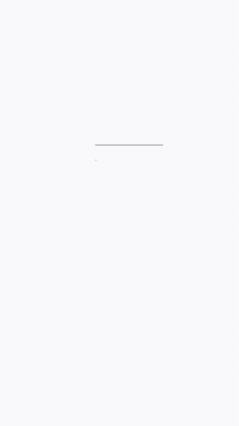

# Preset APPLE DESIGN (desenho técnico que vira lançamento)

Filme curto (12-15 s) em que uma folha de desenho técnico, no estilo dos [desenhos dimensionais da Apple](https://developer.apple.com/accessories/dimensional-drawings/), vai sendo desenhada por uma caneta enquanto a câmera passeia pelo papel. No fim, o desenho ganha cor e acabamento, vira o produto e o título do lançamento sobe. A coreografia vem do [dimensional-drawing](https://github.com/enesozturk/dimensional-drawing) (MIT); o código é nosso, em HyperFrames.



## Batidas (fixas)
| Tempo | O que acontece |
|---|---|
| 0-2,3 s | Close no módulo de câmera: contorno, platô, lentes, cotas S1/B1/B2 e chamadas Ø |
| 2,3-4,4 s | A câmera recua para a vista de trás inteira: aro, botões, eixos, W e H, R1, detalhes A/B, vista lateral |
| 4,6-7,6 s | As camadas saem da vista de trás e sobem na vista explodida (tela, moldura, bateria, placa, câmeras, vidro), com legendas L0-L5 |
| 7,6-9,6 s | Folha inteira: borda, notas, tabela de variáveis, carimbo |
| 9,8 s-fim | A folha apaga, o desenho vira o produto (metal na cor da marca, lentes de vidro, faixa de luz) e o título sobe da máscara |

Cada batida tem 2-3 s, então a tela nunca fica parada.

## Regras fixas
- **Folha monocromática.** Só tinta e cinza; as coisas se distinguem pela espessura, pelo tracejado e pela hachura. A cor da marca (`cor`) entra só nos círculos de detalhe, no metal do produto e na palavra de destaque do título.
- **Traço com espessura constante na tela**, mesmo com o zoom da câmera (`--u` no CSS).
- **Medida nunca é inventada.** `medidas` só com número publicado pelo fabricante ou passado pelo cliente. Sem número, deixar o padrão do exemplo apenas em teste interno.
- **Sem logo de terceiros** no produto: o lugar da marca é um círculo tracejado ("Mark slot").
- **Rótulos da folha em inglês** por padrão (é o visual das folhas da Apple). Com `"rotulos": "pt"`, ficam em português.
- **Som:** traço de lápis suave em cada grupo que se desenha, um sopro em cada movimento de câmera e um grave no momento em que o desenho vira produto (`scripts/sfx_plano.py`). O GIF sai sem som.

## Como fazer
1. Escrever o `plano.json` (campos na docstring do `gerar.py`; exemplos em [`exemplo/plano.json`](exemplo/plano.json) e [`exemplo/plano_vertical.json`](exemplo/plano_vertical.json)).
2. Gerar e renderizar (no painel Terminal, como todo render de motion):
   ```
   python3 gerar.py plano.json <pasta>/projeto --render <pasta>/apple.mp4 --gif
   ```
3. Conferir os quadros em 0,5 · 2,5 · 4,5 · 6,5 · 8,5 · 10,5 · 12,5 s antes de mostrar.
4. Para um GIF maior (site, apresentação, post):
   ```
   ffmpeg -i apple.mp4 -vf "fps=20,scale=960:-1:flags=lanczos,split[a][b];[a]palettegen=max_colors=160[p];[b][p]paletteuse=dither=bayer:bayer_scale=3" apple.gif
   ```

## Formatos
- `w`/`h` 1080×1920 (Reels, padrão): vista de trás em cima, vista explodida e título embaixo, dentro da zona segura.
- 1920×1080 (YouTube, site, GIF): vista de trás à esquerda, vista explodida e título à direita.
- `tema`: `papel` (branco, padrão) ou `noite` (folha escura).

## Hoje o desenho é de celular
O kit desenha um celular com platô de três câmeras, sempre a partir de `medidas`. Para outro produto (relógio, fone, garrafa, card de app), copiar o kit e trocar a geometria das partes 1-3 do `apple.js`, mantendo a câmera, o registro `at()` e o fecho.
