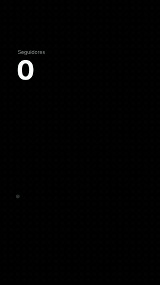

# Preset CURVA (número subindo)

Linha lisa que se desenha sozinha enquanto um número grande sobe com a ponta e assenta no valor final. 4 s, fundo preto (`dark`) ou branco.

Origem: [claude-animation-skills](https://github.com/artemnovitckii/claude-animation-skills) de Artem Novitckii (MIT, `../_reels/LICENSE`), adaptado para a /ogab: 24 qps, textos em pt-BR, kit comum em `presets/_reels/kit`. O guia original em inglês está em `ORIGINAL.md` (campos completos e como trocar a forma).

## Como fazer
1. Números REAIS do cliente, um valor por ponto, do mais antigo ao mais novo. Nunca inventar; com só início e fim, dizer que a curva é ilustrativa.
2. `plano.json`: `label`, `values`, `labels` (meses), `final`, `prefix` (`"R$ "`), `suffix` (`"%"`), `decimals`, `dark`, `locale` (padrão pt-BR). Exemplo em `exemplo/exemplo.json`.
3. `python3 SKILL_DIR/scripts/progresso.py --nome curva -- python3 gerar.py plano.json` (`--snap 3.5` = só um PNG).

## Regras da /ogab que valem aqui
- 24 qps (o kit lê `OGAB_FPS`, padrão 24). Render sempre no painel Terminal com `scripts/progresso.py`.
- Vídeo de marca: trocar a cor de destaque pela oficial do cliente; logo do cliente entra no DaVinci por cima, se pedir.
- Conferir a folha `<saida>.sheet.jpg` (moldura vermelha = área segura do Instagram) antes de mostrar.
- SFX em todo movimento, colocados no DaVinci como no resto da /ogab.
- Um número, uma linha. Rótulo é um substantivo simples ("Seguidores", "Faturamento"), sem selo de "83x" nem palavra de marketing.
