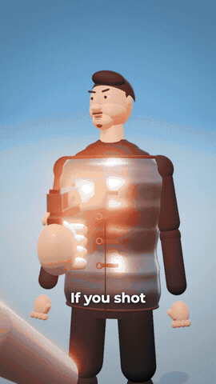

# Preset E SE? 3D

Explicativo 3D estilo "what if" (Zack D. Films): pessoas e objetos 3D de desenho feitos em three.js, céu azul de estúdio, câmera lenta no impacto, faíscas, onda vermelha de força e cortes rápidos. Legenda de 1-3 palavras.

Origem: [claude-animation-skills](https://github.com/artemnovitckii/claude-animation-skills) de Artem Novitckii (MIT, `../_reels/LICENSE`), adaptado para a /ogab: 24 qps, textos em pt-BR, kit comum em `presets/_reels/kit`. O guia original em inglês está em `ORIGINAL.md` (campos completos e como trocar a forma).

## Como fazer
1. Roteiro no formato "E se...", crença comum, virada no "Mas", exemplos, mecanismo, resposta (70-90 palavras para 30 s), aprovado.
2. `cp -R engine <pasta>` e `ln -s ../_reels/kit/node_modules <pasta>/node_modules`.
3. Voz (ElevenLabs v4 ou Kokoro) em `audio/vo.wav`; legendas com `words.py` + `captions.py` (ver `ORIGINAL.md`).
4. Um plano a cada 2-4 s em `src/shots.js`; conferir `node render.mjs stills 1.5,6.8,14 stills`.
5. `node render.mjs video silent.mp4 24` (0,2-0,5 s por quadro) e juntar a voz com ffmpeg.

## Regras da /ogab que valem aqui
- 24 qps (o kit lê `OGAB_FPS`, padrão 24). Render sempre no painel Terminal com `scripts/progresso.py`.
- Vídeo de marca: trocar a cor de destaque pela oficial do cliente; logo do cliente entra no DaVinci por cima, se pedir.
- Conferir a folha `<saida>.sheet.jpg` (moldura vermelha = área segura do Instagram) antes de mostrar.
- SFX em todo movimento, colocados no DaVinci como no resto da /ogab.
- Exemplo pronto: "armadura antiga para uma bala?" (29,5 s, sem voz).
