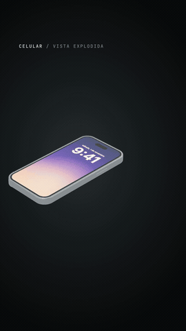

# Preset VISTA EXPLODIDA 3D

Celular 3D que se abre no ar em 6 camadas, cada uma com número, nome e detalhe. ~4 s.

Origem: [claude-animation-skills](https://github.com/artemnovitckii/claude-animation-skills) de Artem Novitckii (MIT, `../_reels/LICENSE`), adaptado para a /ogab: 24 qps, textos em pt-BR, kit comum em `presets/_reels/kit`. O guia original em inglês está em `ORIGINAL.md` (campos completos e como trocar a forma).

## Como fazer
1. `plano.json`: `title`, `subtitle`, `labels` (exatamente 6, de cima para baixo, `[nome, detalhe]`), `time`, `date` (tela de bloqueio), `accent`. Exemplo em `exemplo/exemplo.json`.
2. `python3 SKILL_DIR/scripts/progresso.py --nome explodida -- python3 gerar.py plano.json`.
3. Outro objeto em camadas (tablet, carteira, relógio): copiar o `template.html` e seguir "Another object" no `ORIGINAL.md`.

## Regras da /ogab que valem aqui
- 24 qps (o kit lê `OGAB_FPS`, padrão 24). Render sempre no painel Terminal com `scripts/progresso.py`.
- Vídeo de marca: trocar a cor de destaque pela oficial do cliente; logo do cliente entra no DaVinci por cima, se pedir.
- Conferir a folha `<saida>.sheet.jpg` (moldura vermelha = área segura do Instagram) antes de mostrar.
- SFX em todo movimento, colocados no DaVinci como no resto da /ogab.
- Especificação só com número publicado pelo fabricante ou passado pelo cliente.
