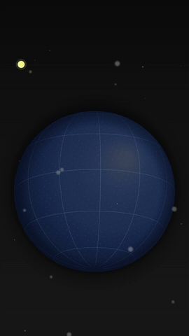

# Preset EXPLICADOR DE NOTÍCIA (pasta `globo`)

Estilo de criação completo, não só o globo: globo 3D azul-marinho com grade e pontos que **gira até cada cidade** da história, **rotas pontilhadas** que crescem entre elas e um **cartão de dado** no canto (seção, etiqueta amarela, número grande contando, rótulo em mono e fonte). Serve para notícia de mercado, economia, viagem, logística, geopolítica, "de onde vem / para onde vai". Tudo isso junto é o estilo: cartão no canto, globo no centro, legenda karaokê embaixo, carimbo e CTA no fim. Recriado quadro a quadro de um Reel de referência (26/10/2026): mesmas proporções, tempos de câmera, tipografia e paleta.



## Linguagem (o que não muda)
- **Fundo** grafite (#0C0C0C → #181818) com poeira cinza em duas profundidades (atrás e desfocada na frente do globo).
- **Globo** no centro (y = 57% da altura, raio = 40% da largura × `zoom`), azul-marinho com luz no alto à direita, pontos finos na superfície e grade a cada 30°. Nunca some: já está na tela no quadro 0 (regra 1h0).
- **Câmera:** cada cena gira o globo até a cidade em `foco` em 1,15 s (curva in-out) e depois deriva devagar; `camera` dentro da cena muda zoom/inclinação na palavra (ex.: afasta quando o número entra, como na referência).
- **Pinos:** a cidade em foco tem a cabeça amarela grande e um anel que abre e solta uma onda; as outras ficam brancas. O nome da cidade fica **deitado na superfície** do globo (acompanha a curvatura).
- **Rotas:** pontinhos amarelos que nascem na origem e crescem pelo arco (`arco` = altura da curva; 0,03 rasteiro, 0,2 por cima do oceano), somem atrás do globo e ficam na tela até o fim (a rede vai crescendo).
- **Cartão:** linha da série em mono espaçado, pílula escura com a bola amarela e `• SEÇÃO`, linha de fontes, etiqueta amarela, número em Inter Tight 800 na cor de destaque, divisor branco, rótulo e sub em JetBrains Mono, tópicos em bullet (o último entra amarelo e o anterior volta para branco).
- **Carimbo** (opcional): caixa inclinada -4° com borda amarela que bate e assenta (sem quique).
- **CTA** (cena `"tipo": "cta"`): o globo afasta, pergunta grande em branco e botão amarelo.
- **Cor:** `cor` troca o amarelo (#F4F78A) pela cor da marca; o resto fica neutro.

## Regras
- **O número vem dos fatos aprovados** e aparece EXATO (`valor`, `decimais`; negativo sai com o sinal de menos tipográfico −). Nunca inventar nem arredondar.
- **`fontes` é obrigatória** quando alguma cena tem número (o `gerar.py` recusa sem ela).
- **Legenda:** `"legenda": false` é o padrão. Na timeline do editor a legenda é do software (regra 1h3) e a faixa de baixo do globo fica livre para ela. A legenda karaokê do preset (palavra falada em amarelo, o resto em cinza, caixa escura) só entra com `"legenda": true` quando a entrega é o MP4 pronto (editor `nenhum`) ou o usuário pediu.
- **Tempo preso à fala:** passar `transcricao` (do `transcrever.py`) e usar palavras em `em` ("em": "caiu"). Sem transcrição, a `fala` de cada cena dá um tempo estimado (bom para prévia, não para entrega).
- **Uma ideia por cena**, 5 a 12 s cada; troca de cena = troca de cidade ou de assunto.
- Cidades: a tabela `CIDADES` do `gerar.py` já tem capitais e as principais praças financeiras; outra cidade vai em `"cidades"` com `lat`/`lon`.

## Como fazer
```
python3 gerar.py plano.json <pasta> [--render globo.mp4 --gif]
```
1. Escrever o `plano.json` (campos na docstring do `gerar.py`; exemplo em [`exemplo/plano.json`](exemplo/plano.json)). Uma cena por bloco do roteiro: `foco`, `secao`, `etiqueta`, `numero`/`rotulo`/`sub`, `topicos`, `rotas`.
2. Gerar o projeto e passar pelo storyboard (`scripts/storyboard.py <pasta>`), depois parar e esperar a aprovação.
3. Renderizar (`--workers 2`; o globo é desenhado em canvas a partir do tempo, então qualquer quadro sai igual) e rodar `scripts/revisor.py <mp4> --pasta <pasta>`.
4. Na timeline: o MP4 do globo na V1 (vídeo só motion + narração) ou como cena inteira entre os trechos do apresentador.

## Medidas da referência (para não perder a fidelidade ao mexer)
| Elemento | Valor (em 1080×1920) |
|---|---|
| Globo | centro y 0,565 H; raio 0,35 W (afastado) a 0,55 W (perto) |
| Cartão | x 90, topo 0,152 H; série 24 px; pílula 62 px; etiqueta 21 px; número 168 px; rótulo 25 px |
| Legenda | centro y 0,775 H; 48 px; caixa rgba(17,17,16,.78) |
| Cores | fundo #0C0C0C/#181818; globo #1D3058 (luz #414C64); destaque #F4F78A |
