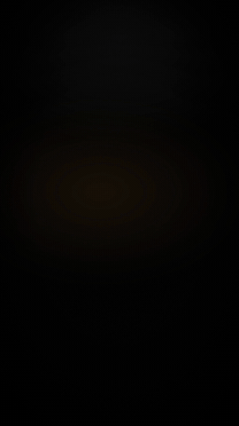

# Preset LAUNCH (filme de lançamento de produto)

Vídeo curto (12-25 s) que apresenta um produto digital (site, app, SaaS, curso) com as telas reais dele. O ponto de partida foi o [/brag](https://github.com/latent-spaces/brag) (MIT). O acabamento segue a linguagem dos filmes de lançamento de produto (estilo Apple), sem copiar nenhum material deles.



## Regra fixa: acabamento premium, nunca solto
- **Fundo:** preto. Só um foco de luz suave em cima e uma névoa mínima na cor da marca. Nada de grade, neon, cartões coloridos ou emoji.
- **Uma ideia por cena:** no gancho, as frases entram uma de cada vez (`||`), e a anterior sai antes da próxima.
- **Curvas de movimento:**
  - revelações longas que freiam no fim (`expo.out`, 1,0-1,2 s);
  - câmera sem tranco (`power2.inOut`, `sine.inOut`);
  - nada linear no que se vê.
- **Texto:**
  - cada linha sobe de dentro de uma máscara;
  - linhas coladas (a margem negativa devolve a folga da máscara);
  - letra grande, só a palavra-chave na cor da marca.
- **Produto:** painel de vidro flutuando em 3D, girando devagar enquanto a câmera se aproxima. Tem reflexo no chão e uma faixa de luz passando no vidro. A página rola até o ponto que importa.
- **Som contido:**
  - grave na entrada do logo e no fecho;
  - sopros suaves antes de cada cena e um pad escuro por baixo;
  - nada de whoosh alto.
  - Música do usuário (Artlist) só se ele pedir.
- **Conferência:** antes de entregar, conferir os quadros. Acento e perna do "g" não podem ser cortados, e o texto não pode ficar por cima do painel.

## Letra (`"letra"` no plano)
| Valor | Visual |
|---|---|
| `apple` (padrão) | Inter Tight 700, branca chapada, centralizada, palavra-chave na cor da marca |
| `editorial` | Inter Tight 600 alinhada à esquerda, palavra-chave em Instrument Serif itálica |
| `cinema` | tudo em Instrument Serif grande, centralizada, palavra-chave em itálico |

## Como fazer
1. **Capturar o produto:**
   ```
   python3 capturar.py <url> <pasta>/caps
   ```
   Gera `desktop.png`, `celular.png` e `topo.png` com a página inteira, depois de rolar até o fim para as animações de entrada aparecerem. Também gera `marca.json` com o nome, a frase, a descrição e a cor (lida em hex e em hsl, ignorando WhatsApp, Facebook e Google). Funciona com `http://localhost` de um app em desenvolvimento.
2. **Escrever o `plano.json`:**
   - roteiro **gancho → logo → tela → lista → cta**, com 2-4 palavras por linha;
   - campos completos na docstring do `gerar.py`;
   - exemplo em [`exemplo/plano.json`](exemplo/plano.json).
3. **Gerar, renderizar e tirar o GIF de prévia:**
   ```
   python3 gerar.py plano.json <pasta>/projeto --render <pasta>/launch.mp4 --gif
   ```
   Isso gera `launch.mp4` (60 fps) e `launch.gif`.
4. **Som:** mixar com ffmpeg como descrito acima, ou levar o MP4 para a timeline do cliente e colocar a música lá.

## Cliente com marca
- `cor` e `cor2` vêm da marca. O padrão é dourado `#C4A34F` / `#F2E2B3`.
- `marca.logo` entra no logo e no fecho (logo largo é detectado sozinho).
- Assunto com risco, como mercado financeiro ou saúde: `aviso` no `cta`.
- Promessa de resultado nunca vai no texto.
