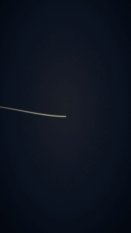

# Preset LINHA (um traço só)

O filme inteiro é **uma linha fina e contínua** (champanhe sobre azul-noite no tema padrão). A câmera segue a ponta da
caneta enquanto ela escreve palavras em cursiva de traço único e desenha formas que contam a história. As linhas
antigas apagam para ~40% e as formas novas têm um brilho leve. No fim a linha fecha um monograma, que se enche de cor
a partir do contorno (a linha vira superfície). A câmera recua e tudo assenta como um pôster: marca em serifa
espaçada, um fio e a frase.

Bom para: marca premium, luxo, arquitetura, imobiliária, joalheria, escritório, consultoria, institucional curto,
abertura e fecho de vídeo, manifesto de 3 ideias ("um traço, uma casa, um legado"), história de origem de marca.
Não é para dado com fonte (use gráfico), lista longa nem tutorial (use sketch).
**Diferença do sketch:** o sketch é marcador colorido tremido com cartões e texto digitado. A linha é UM fio de metal,
de espessura constante e sem tremido; a palavra é escrita à mão pela própria linha, sem digitação. Tem uma cor só e
muito espaço vazio.



Exemplo: `exemplo/plano.json` gera `exemplo.mp4` (vertical, 12 s, marca fictícia) e `exemplo.gif`.

## Como gerar
```
python3 presets/linha/gerar.py plano.json <pasta>/motions/linha [--tema padrao|<marca>|tema.json] --render <pasta>/motions/linha.mp4 [--gif]
```
Conferir antes do render: `node scripts/quadros.mjs <pasta>/index.html <saida> 0.3,2,5,8,10,11.5`. Depois do render:
`python3 scripts/revisor.py linha.mp4 --pasta <pasta>`. O motion sai mudo, sem fade de entrada nem de saída
(transição no editor).

## Plano
```json
{ "formato": "vertical", "fps": 30,
  "cenas": [
    {"palavra": "um traço",  "forma": "broto",  "dur": 2.4},
    {"palavra": "uma casa",  "forma": "casa",   "em": 2.4},
    {"palavra": "um legado", "forma": "arvore"},
    {"tipo": "fecho", "inicial": "A", "marca": "Aurum", "frase": "arquitetura que atravessa gerações", "dur": 4.8}
  ] }
```
- **Estação** = palavra (escrita primeiro, da esquerda para a direita) + forma (desenhada embaixo, espelhada, da
  direita para a esquerda). A linha desce pela margem e as voltas ficam fora do texto, então nenhuma ligação cruza
  palavra. Uma das duas pode faltar.
- `dur` (padrão 2,4 s) ou `em` (segundo em que a estação começa: amarrar à palavra da narração).
- Palavra curta, até ~14 letras (é reduzida para caber em 640 px). Acentos e cedilha funcionam (são escritos no fim
  da palavra, como à mão).
- **Formas** (`formas.py`, um traço só): casa, arvore, broto, predios, diamante, coroa, chave, montanha, onda,
  relogio, coracao, anel. Forma nova ou logo do cliente: `"forma": {"d": "M... C..."}` (um path de SVG sem arco A; o
  ideal é um traço só). Para entrar na biblioteca: caixa 0..100 começando em (0,100) e terminando em (100,100).
- **Fecho** (opcional, padrão 4,8 s): anel, inicial em cursiva dentro dele, preenchimento metálico (a letra fica
  gravada na cor do fundo), recuo para o pôster, fio, marca em serifa espaçada e frase, que sobem por máscara.
  Mantém ~1 s de pôster parado com um empurrão lento de câmera.

## Tema (cores só da marca do cliente)
`temas/padrao.json`: fundo `#0B1320`, linha `#E9D7A5`, texto `#EFE3C2`, grão 0,07. Marca nova: copiar para
`temas/<marca>.json` e trocar as 3 cores (fundo = fundo da marca, linha = cor de destaque/metal, texto = cor da marca
escrita). Para trocar só num vídeo, use `"cores"` no plano. O dourado da moeda, a ponta e a vinheta saem da linha e
do fundo (mesmo tom, sem degradê de outra cor).

## Regras do estilo
- Espessura constante na tela (3,2 px em 1080), ponta redonda, uma cor só.
- **Brilho só no traço das formas e ligações, nunca no texto** (palavras, inicial, marca e frase são nítidas).
- **A ponta da caneta é um ponto nítido, sem halo.** No original o halo da ponta embaçava a letra que estava sendo
  escrita.
- Fundo azul-noite chapado, com vinheta do mesmo tom, pontos de prancheta em paralaxe e grão com semente. Sem degradê
  roxo/azul.
- Tempo da caneta: spline monótona por estação, que freia e para no fim de cada palavra e forma (pausa de pontuação).
  Curva da câmera e do recuo: cubic-bezier(0.65, 0, 0.35, 1). A marca sobe com expo.out. Nada de quique, elástico ou
  digitação.
- Câmera: enquadra a estação na área segura 900x1200 com 30% de peso na ponta, suavização gaussiana (~0,26 s).
  Começa colada na ponta (gancho: a linha já está correndo no quadro 0 e escreve aos 0,3 s).
- Tudo é determinístico: o `gerar.py` calcula traços, tempos e câmera quadro a quadro, e o `kit/linha.js` desenha
  `render(t)` puro.
- Linhas antigas saindo pela borda durante a viagem da câmera são intencionais (a câmera anda pelo desenho). O que
  importa (palavra e forma da estação, pôster final) fica dentro da área segura.

## Som (desenho de som do Gab, `docs/etapas/sonorizacao.md`)
Piano de feltro ou cordas suaves. Sussurro de caneta no papel acompanhando a velocidade da ponta, pausas secas no fim
de cada palavra, um sino delicado quando o monograma enche. Sem impacto pesado.

## Créditos e licenças
- Ideia e técnicas portadas (não copiadas) do demo **02-line-art** do repositório **mg-styles-15** de Vincentwei1021
  (licença MIT, Copyright (c) 2026 Vincentwei1021). Inclui o traço que se desenha, o apagamento por idade, a câmera
  que segue a ponta, a linha que vira superfície e a curva 0.65/0/0.35/1. O código deste preset foi escrito do zero
  (SVG + dashoffset no lugar de Canvas2D).
- **Hershey Script 1-stroke** (`fontes/HersheyScript1.svg`, versão SVG de Windell H. Oskay, Evil Mad Scientist).
  Agradecimentos obrigatórios pela licença: as Hershey Fonts foram criadas pelo Dr. A. V. Hershey no U. S. National
  Bureau of Standards; o formato dos dados foi criado por James Hurt (Cognition, Inc.). Licença completa no cabeçalho
  do arquivo.
- EB Garamond (SIL Open Font License, `assets/fontes/EBGaramond/OFL.txt`). GSAP 3.14 (licença padrão GreenSock).
