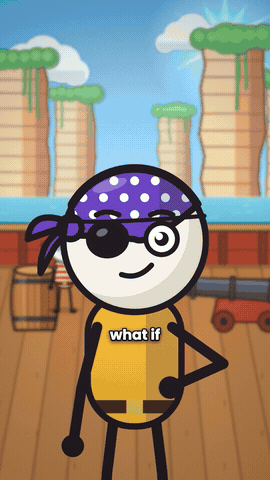

# Preset BONECOS DE PALITO

Explicativo 30-45 s em desenho animado colorido, todo feito em código: bonecos de palito com cabeça branca grande e rosto expressivo, câmera sempre andando, chicote entre planos, legenda de 1-2 palavras e trilha e SFX sintetizados.

Origem: [claude-animation-skills](https://github.com/artemnovitckii/claude-animation-skills) de Artem Novitckii (MIT, `../_reels/LICENSE`), adaptado para a /ogab: 24 qps, textos em pt-BR, kit comum em `presets/_reels/kit`. O guia original em inglês está em `ORIGINAL.md` (campos completos e como trocar a forma).

## Como fazer
1. Roteiro (110-120 palavras, gancho "e se", crença comum, virada no "Mas", exemplos, mecanismo, resposta) aprovado pelo usuário.
2. `cp -R engine/template <pasta>` e trocar `script.json`.
3. Voz: ElevenLabs v4 (padrão da /ogab, texto pelo `texto_voz.py`) ou Kokoro grátis para volume (`bash ../_reels/kit/setup.sh --voice`, ~1 GB uma vez). Salvar em `audio/vo.wav`.
4. Reescrever `web/shots.js` (10-12 planos de 2-4 s) e conferir com `node engine/tools/render.js stills 1.5,4.2,9`.
5. `bash engine/make.sh <pasta>` (rodar pelo Terminal com progresso).

## Regras da /ogab que valem aqui
- 24 qps (o kit lê `OGAB_FPS`, padrão 24). Render sempre no painel Terminal com `scripts/progresso.py`.
- Vídeo de marca: trocar a cor de destaque pela oficial do cliente; logo do cliente entra no DaVinci por cima, se pedir.
- Conferir a folha `<saida>.sheet.jpg` (moldura vermelha = área segura do Instagram) antes de mostrar.
- SFX em todo movimento, colocados no DaVinci como no resto da /ogab.
- O motor desenha a 30 qps; a /ogab converte para 24 no fim (`-r 24`).
- Exemplo pronto (inglês) em `engine/template`: "tapa-olho de pirata".
