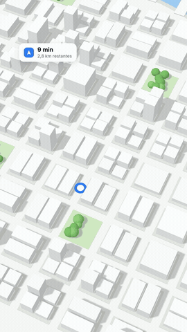

# Preset ROTA 3D

Cidade 3D de maquete: a rota se desenha até o pino vermelho, um ponto anda por ela e o cartão mostra minutos restantes até "Chegou". 4 s.

Origem: [claude-animation-skills](https://github.com/artemnovitckii/claude-animation-skills) de Artem Novitckii (MIT, `../_reels/LICENSE`), adaptado para a /ogab: 24 qps, textos em pt-BR, kit comum em `presets/_reels/kit`. O guia original em inglês está em `ORIGINAL.md` (campos completos e como trocar a forma).

## Como fazer
1. `plano.json`: `destination`, `minutes`, `distance`, `unit` (km), `places` (5 nomes decorativos do bairro), `accent` (cor da rota = cor da marca), `seed` (outra cidade). Exemplo em `exemplo/exemplo.json`.
2. `python3 SKILL_DIR/scripts/progresso.py --nome rota -- python3 gerar.py plano.json`.
3. Forma da rota diferente: ver "Changing the route" no `ORIGINAL.md`.

## Regras da /ogab que valem aqui
- 24 qps (o kit lê `OGAB_FPS`, padrão 24). Render sempre no painel Terminal com `scripts/progresso.py`.
- Vídeo de marca: trocar a cor de destaque pela oficial do cliente; logo do cliente entra no DaVinci por cima, se pedir.
- Conferir a folha `<saida>.sheet.jpg` (moldura vermelha = área segura do Instagram) antes de mostrar.
- SFX em todo movimento, colocados no DaVinci como no resto da /ogab.
- O mapa é ilustrativo, não geografia real: os nomes são decoração.
